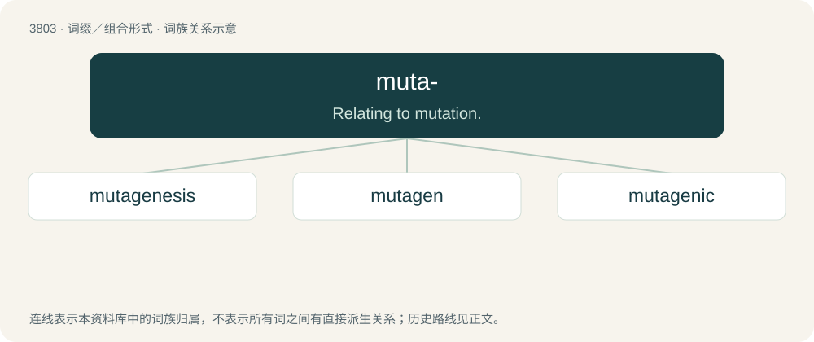

# 3837 · muta- — Relating to mutation.

[总目录](../00_总目录_按常用程度.md)

**类型**：词缀／组合形式　｜　**来源语言**：见词源记录

## 核心含义与来源

- 核心含义：Relating to mutation.
- 英文含义：Relating to mutation.
- 词形：muta-

**来源记录 1**（前缀／前置成分；Relating to mutation.）

From mutation, itself from Latin mūtātiō, by analogy with other Graeco-Latin prefixes.

## 词族图

## 单词速览（常用到不常用）

| 单词 | 音标 | 释义 |
|---|---|---|
| [mutagenesis](#w-1) | /,mjutəˈdʒenisis/ | \[医\] 诱变, 引起突变 |
| [mutagen](#w-2) | /ˈmjuːtəd͡ʒn̩/ | n. 诱变剂；\[医\] 诱变剂, 致变物 |
| [mutagenic](#w-3) | /.mjuːtəˈdʒenik/ | a. 诱变的；\[医\] 诱变的 |

## 逐词详解

### 1. mutagenesis

**词性**：名词　｜　**音标**：/,mjutəˈdʒenisis/

**中文释义**：\[医\] 诱变, 引起突变

**英文义项**：The creation or formation of a genetic mutation.

**构词拆分**：muta- + genesis

**词源与演化**：

From muta- + genesis.

### 2. mutagen

**词性**：名词　｜　**音标**：/ˈmjuːtəd͡ʒn̩/

**中文释义**：n. 诱变剂；\[医\] 诱变剂, 致变物

**英文义项**：Any agent or substance that can cause genetic mutation.

**构词拆分**：muta- + -gen

**词源与演化**：

From muta- + -gen.

**例句**：

> Ziri was given a dose of the mutagen.

### 3. mutagenic

**词性**：形容词　｜　**音标**：/.mjuːtəˈdʒenik/

**中文释义**：a. 诱变的；\[医\] 诱变的

**英文义项**：Capable of causing mutation. / Relating to mutagenesis.

**构词拆分**：muta- + -genic

**词源与演化**：

From muta- + -genic.

**例句**：

> Don't smell it. It might be mutagenic.
