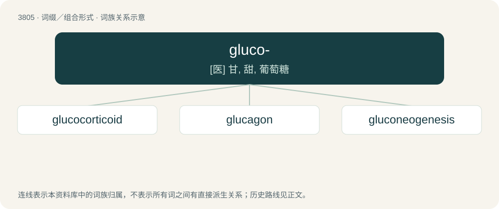

# 3838 · gluco- — \[医\] 甘, 甜, 葡萄糖

[总目录](../00_总目录_按常用程度.md)

**类型**：词缀／组合形式　｜　**来源语言**：见词源记录

## 核心含义与来源

- 核心含义：\[医\] 甘, 甜, 葡萄糖
- 英文含义：sweetness
- 词形：gluco-

**来源记录 1**（前缀／前置成分；sweetness）

From the New Latin combining form from Ancient Greek γλυκύς (glukús, “sweet”).

## 词族图

## 单词速览（常用到不常用）

| 单词 | 音标 | 释义 |
|---|---|---|
| [glucocorticoid](#w-1) | /,^luːkəuˈkɔːti,kɔid/ | \[化\] 糖皮质素; 糖皮质激素；\[医\] 糖\[肾上腺\]皮质激素 |
| [glucagon](#w-2) | 英 /ˈɡluːkəɡən/；美 /ˈɡlukəˌɡɑn/ | n. \[生化\]胰高血糖素,胰增血糖素 |
| [gluconeogenesis](#w-3) | /,^luːkə,niːəuˈdʒenisis/ | n. \[生化\]糖质新生 |

## 逐词详解

### 1. glucocorticoid

**词性**：名词　｜　**音标**：/,^luːkəuˈkɔːti,kɔid/

**中文释义**：\[化\] 糖皮质素; 糖皮质激素；\[医\] 糖\[肾上腺\]皮质激素

**英文义项**：Any of a group of steroid hormones, produced by the adrenal cortex, that are involved in metabolism and have anti-inflammatory properties.

**构词拆分**：gluco- + corticoid

**词源与演化**：

From gluco- + corticoid.

### 2. glucagon

**词性**：名词　｜　**音标**：英 /ˈɡluːkəɡən/；美 /ˈɡlukəˌɡɑn/

**中文释义**：n. \[生化\]胰高血糖素,胰增血糖素

**英文义项**：A peptide hormone, produced by the pancreas, that opposes the action of insulin by stimulating the production of sugar

**词源与演化**：

From gluco- + Ancient Greek ἄγων (ágōn), present participle of ἄγω (ágō, “push forward, put in motion; stir up; excite, urge”).

### 3. gluconeogenesis

**词性**：名词　｜　**音标**：/,^luːkə,niːəuˈdʒenisis/

**中文释义**：n. \[生化\]糖质新生

**英文义项**：The metabolic process in which glucose is formed, mostly in the liver, from non-carbohydrate precursors

**构词拆分**：gluco- + neogenesis

**词源与演化**：

From gluco- + neogenesis.
