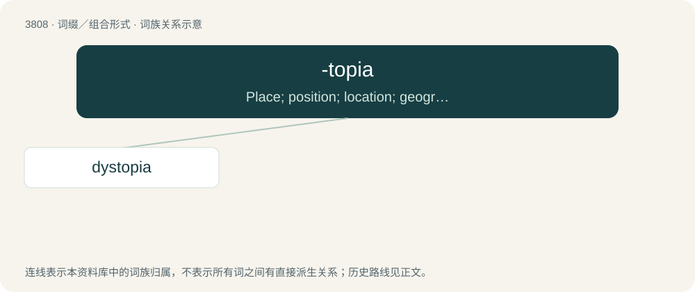

# 3840 · -topia — Place; position; location; geographic region.

[总目录](../00_总目录_按常用程度.md)

**类型**：词缀／组合形式　｜　**来源语言**：见词源记录

## 核心含义与来源

- 核心含义：Place; position; location; geographic region.
- 英文含义：Place; position; location; geographic region.
- 词形：-topia

**来源记录 1**（后缀／后置成分；Place; position; location; geographic region.）

Back-formation from utopia and other words ultimately deriving from Ancient Greek τόπος (tópos, “place”).

## 词族图

## 单词速览（常用到不常用）

| 单词 | 音标 | 释义 |
|---|---|---|
| [dystopia](#w-1) | 英 /dɪsˈtəʊ.pi.ə/；美 /dɪsˈtoʊ.pi.ə/ | n. 非理想化的地方；\[医\] 异位, 错位 |

## 逐词详解

### 1. dystopia

**词性**：名词　｜　**音标**：英 /dɪsˈtəʊ.pi.ə/；美 /dɪsˈtoʊ.pi.ə/

**中文释义**：n. 非理想化的地方；\[医\] 异位, 错位

**英文义项**：A miserable, dysfunctional state or society that has a very poor standard of living or severe censorship, oppression, etc. / Anatomical tissue that is not found in its usual place.

**构词拆分**：dys- + -topia

**词源与演化**：

From dys- + -topia, as if from Ancient Greek δυσ- (dus-, “bad”) + τόπος (tópos, “place, region”) + -ία (-ía), based on utopia being reinterpreted as eu-topia.

**例句**：

> The patient suffers from adrenal dystopia.

该用例对应义项：Anatomical tissue that is not found in its usual place.
