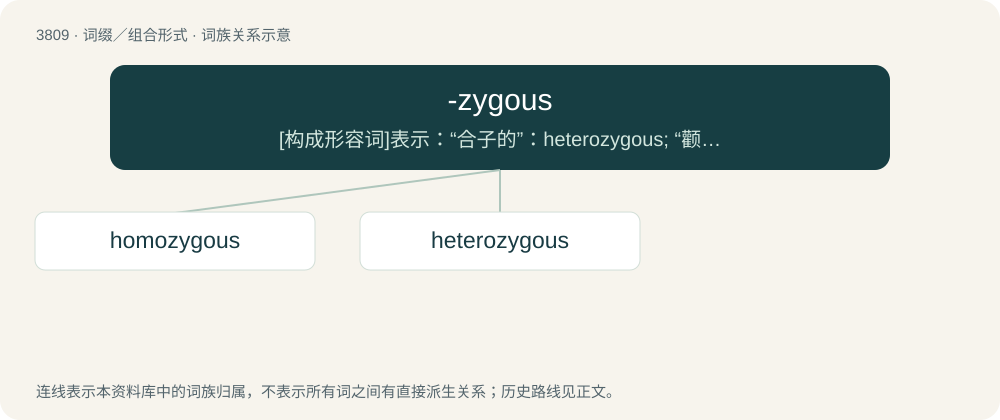

# 3841 · -zygous — \[构成形容词\]表示：“合子的”：heterozygous; “颧骨的”

[总目录](../00_总目录_按常用程度.md)

**类型**：词缀／组合形式　｜　**来源语言**：见词源记录

## 核心含义与来源

- 核心含义：\[构成形容词\]表示：“合子的”：heterozygous; “颧骨的”
- 英文含义：Having or originating from a specified state as a result of conditions in the zygote stage of development.
- 词形：-zygous

**来源记录 1**（后缀／后置成分；Having or originating from a specified state as a result of conditions in the zygote stage of development.）

From zygo- + -ous.

## 词族图

## 单词速览（常用到不常用）

| 单词 | 音标 | 释义 |
|---|---|---|
| [homozygous](#w-1) | /ˌhəʊməʊˈzaɪɡəs/ | \[医\] 纯合的, 同型\[接合\]的 |
| [heterozygous](#w-2) | /,hetərəuˈzai^əs/ | a. \[生\]杂合的 |

## 逐词详解

### 1. homozygous

**词性**：形容词　｜　**音标**：/ˌhəʊməʊˈzaɪɡəs/

**中文释义**：\[医\] 纯合的, 同型\[接合\]的

**英文义项**：Of an organism in which both copies of a given gene have the same allele

**构词拆分**：From homo- + -zygous.

**词源与演化**：

From homo- + -zygous.

### 2. heterozygous

**词性**：形容词　｜　**音标**：/,hetərəuˈzai^əs/

**中文释义**：a. \[生\]杂合的

**英文义项**：Of an organism: having two different alleles in a given gene.

**构词拆分**：hetero- + -zygous

**词源与演化**：

From hetero- + -zygous.

**例句**：

> Heterozygous for eye color.

该用例对应义项：having dissimilar alleles at corresponding chromosomal loci
