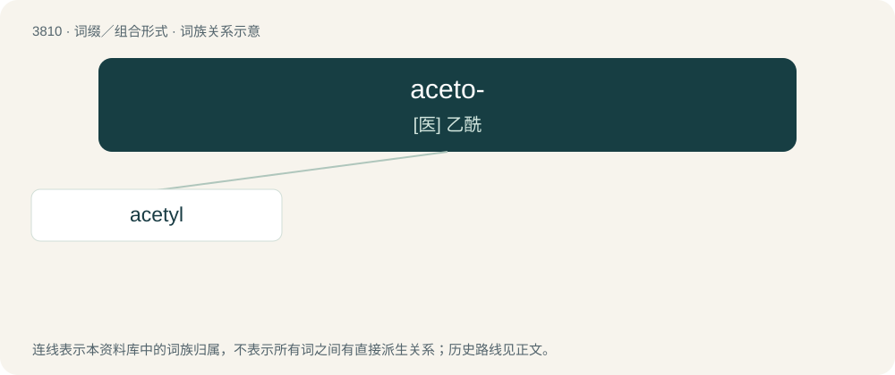

# 3842 · aceto- — \[医\] 乙酰

[总目录](../00_总目录_按常用程度.md)

**类型**：词缀／组合形式　｜　**来源语言**：见词源记录

## 核心含义与来源

- 核心含义：\[医\] 乙酰
- 英文含义：Containing a methyl group bonded to a carbonyl group (CH₃CO-); e.g., acetophenone
- 词形：aceto-

**来源记录 1**（前缀／前置成分；Containing a methyl group bonded to a carbonyl group (CH₃CO-); e.g., acetophenone）

From Latin acētum (“vinegar”), because acetic acid is a constituent of vinegar.

## 词族图

## 单词速览（常用到不常用）

| 单词 | 音标 | 释义 |
|---|---|---|
| [acetyl](#w-1) | 英 /əˈsiːtaɪl/；美 /ˈæsətɪl/ | n. 乙酰(基)；\[化\] 乙酰; 乙酰基 |

## 逐词详解

### 1. acetyl

**词性**：名词　｜　**音标**：英 /əˈsiːtaɪl/；美 /ˈæsətɪl/

**中文释义**：n. 乙酰(基)；\[化\] 乙酰; 乙酰基

**英文义项**：The univalent radical CH₃CO- derived from acetic acid.

**构词拆分**：acet- + -yl；aceto- + -yl
