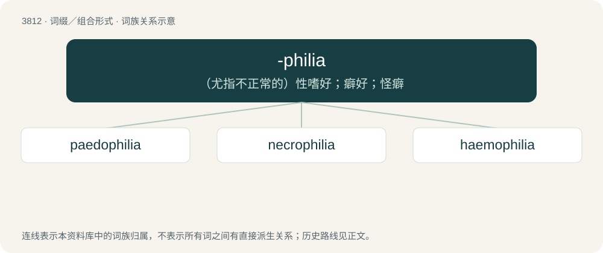

# 3843 · -philia — （尤指不正常的）性嗜好；癖好；怪癖

[总目录](../00_总目录_按常用程度.md)

**类型**：词缀／组合形式　｜　**来源语言**：见词源记录

## 核心含义与来源

- 核心含义：（尤指不正常的）性嗜好；癖好；怪癖
- 英文含义：Used to form nouns meaning liking, love (for something).
- 词形：-philia

**来源记录 1**（后缀／后置成分；Used to form nouns meaning liking, love (for something).）

From Ancient Greek φιλία (philía, “(fraternal) love”).

## 词族图

## 单词速览（常用到不常用）

| 单词 | 音标 | 释义 |
|---|---|---|
| [paedophilia](#w-1) | /ˌpiːdəˈfɪliə/ | n. 恋童癖 |
| [necrophilia](#w-2) | 英 /ˌnɛkɹə(ʊ)ˈfɪlɪə/；美 /nɛkɹoʊˈfɪli.ə/ | n. 恋尸狂；\[法\] 恋尸欲, 尸体色情, 奸尸 |
| [haemophilia](#w-3) | /ˌhiːməˈfɪliə | n. \[医\]血友病, 出血不止症 |

## 逐词详解

### 1. paedophilia

**词性**：名词　｜　**音标**：/ˌpiːdəˈfɪliə/

**中文释义**：n. 恋童癖

**英文义项**：UK standard spelling of pedophilia.

**构词拆分**：paedo- + -philia

**词源与演化**：

From paedo- + -philia.

### 2. necrophilia

**词性**：名词　｜　**音标**：英 /ˌnɛkɹə(ʊ)ˈfɪlɪə/；美 /nɛkɹoʊˈfɪli.ə/

**中文释义**：n. 恋尸狂；\[法\] 恋尸欲, 尸体色情, 奸尸

**英文义项**：A pathological attraction to dead bodies. / Sexual activity with corpses.

**词源与演化**：

From necro- (Ancient Greek νεκρός (nekrós, “corpse, dead”)) + -philia (Ancient Greek φιλία (philía, “affection”)), after German Nekrophilie (in Krafft-Ebing 1887).

**例句**：

> Sami read anything related to necrophilia.

### 3. haemophilia

**词性**：名词　｜　**音标**：/ˌhiːməˈfɪliə

**中文释义**：n. \[医\]血友病, 出血不止症

**英文义项**：Any of several hereditary illnesses that impair the body's ability to control bleeding, usually passed from mother to son.

**构词拆分**：haemo- + -philia

**词源与演化**：

From haemo- + -philia, from Ancient Greek αἷμα (haîma, “blood”) + φιλία (philía, “friendship”). Originally called haemorrhaphilia, probably from the word haemorrhage.

**例句**：

> All the jobs I aspired to were denied to me due to my haemophilia.
