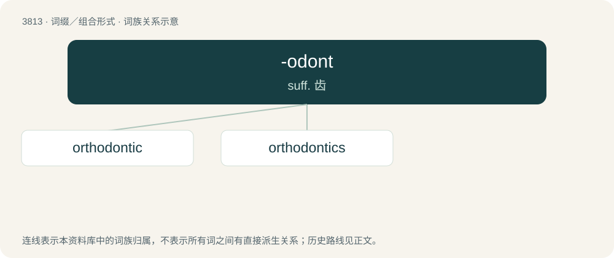

# 3845 · -odont — suff. 齿

[总目录](../00_总目录_按常用程度.md)

**类型**：词缀／组合形式　｜　**来源语言**：见词源记录

## 核心含义与来源

- 核心含义：suff. 齿
- 英文含义：tooth; toothed
- 词形：-odont

**来源记录 1**（后缀／后置成分；tooth; toothed）

From the oblique stem of Ancient Greek ὀδούς (odoús).

## 词族图

## 单词速览（常用到不常用）

| 单词 | 音标 | 释义 |
|---|---|---|
| [orthodontic](#w-1) |  | \[医\] 牙正常的 |
| [orthodontics](#w-2) | /,ɔːθəuˈdɔntiks/ | \[医\] 正牙学 |

## 逐词详解

### 1. orthodontic

**词性**：形容词

**中文释义**：\[医\] 牙正常的

**英文义项**：Of, or relating to the dental speciality of orthodontics.

**构词拆分**：orthodontia + -ic；ortho- + -odont + -ic

**词源与演化**：

From orthodontia + -ic, equivalent to ortho- + -odont + -ic.

### 2. orthodontics

**词性**：名词　｜　**音标**：/,ɔːθəuˈdɔntiks/

**中文释义**：\[医\] 正牙学

**英文义项**：A specialty of dentistry concerned with correcting misalignment of teeth.

**构词拆分**：orthodontic + -s；ortho- (“correct, straight”) + -odont + -ics

**词源与演化**：

From orthodontic + -s, equivalent to ortho- (“correct, straight”) + -odont + -ics.
