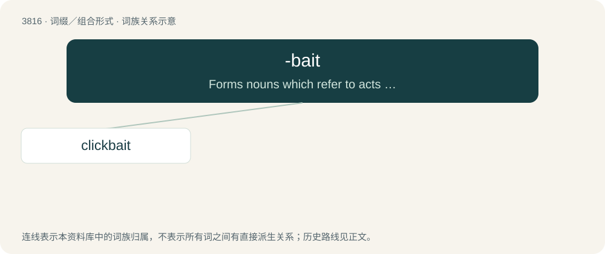

# 3848 · -bait — Forms nouns which refer to acts of manipulation or manipulative material which seek to elicit a particular response.

[总目录](../00_总目录_按常用程度.md)

**类型**：词缀／组合形式　｜　**来源语言**：见词源记录

## 核心含义与来源

- 核心含义：Forms nouns which refer to acts of manipulation or manipulative material which seek to elicit a particular response.
- 英文含义：Forms nouns which refer to acts of manipulation or manipulative material which seek to elicit a particular response.
- 词形：-bait

**来源记录 1**（后缀／后置成分；Forms nouns which refer to acts of manipulation or manipulative material which seek to elicit a particular response.）

From bait.

## 词族图

## 单词速览（常用到不常用）

| 单词 | 音标 | 释义 |
|---|---|---|
| [clickbait](#w-1) | 英 /ˈklɪkbeɪt/ | 【英文】Website content that is aimed at generating advertising revenue, especially at the expense of quality or accuracy, relying on sensationalist headlines to attract click-throughs; such headlines. |

## 逐词详解

### 1. clickbait

**词性**：名词　｜　**音标**：英 /ˈklɪkbeɪt/

**英文义项**：Website content that is aimed at generating advertising revenue, especially at the expense of quality or accuracy, relying on sensationalist headlines to attract click-throughs; such headlines.

**构词拆分**：click + -bait

**词源与演化**：

From click + -bait (“manipulation to elicit a particular response”).

**例句**：

> After falling victim to clickbait, my computer caught a virus.
