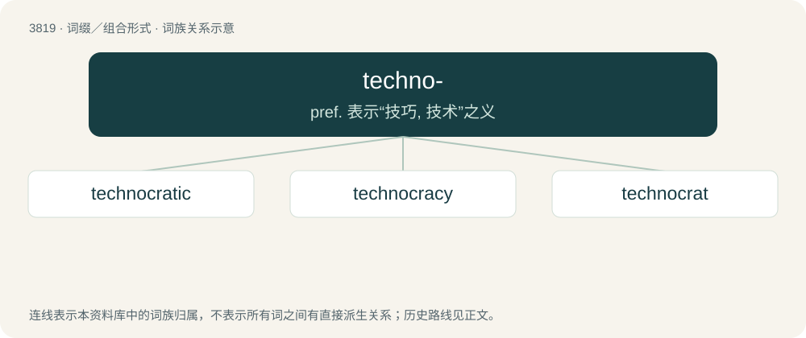

# 3851 · techno- — pref. 表示“技巧, 技术”之义

[总目录](../00_总目录_按常用程度.md)

**类型**：词缀／组合形式　｜　**来源语言**：见词源记录

## 核心含义与来源

- 核心含义：pref. 表示“技巧, 技术”之义
- 英文含义：Relating to technology.
- 词形：techno-

**来源记录 1**（前缀／前置成分；Relating to technology.）

Derived from Ancient Greek τεχνο- (tekhno-, “skill”).

## 词族图

## 单词速览（常用到不常用）

| 单词 | 音标 | 释义 |
|---|---|---|
| [technocratic](#w-1) | 英 /tɛk.nəˈkɹæt.ɪk/ | a. 由技术专家官员组成的；受技术官僚影响的 |
| [technocracy](#w-2) | /tɛkˈnɒkɹəsi/ | n. 技术专家政治论, 技术专家治国论；\[经\] 专家管理, 技术管理 |
| [technocrat](#w-3) | 英 /ˈtɛknə(ʊ)kɹat/ | n. 技术专家治国论者, 技术专家统治论者 |

## 逐词详解

### 1. technocratic

**词性**：形容词　｜　**音标**：英 /tɛk.nəˈkɹæt.ɪk/

**中文释义**：a. 由技术专家官员组成的；受技术官僚影响的

**英文义项**：Of, or relating to a technocrat or technocracy.

**构词拆分**：techno- + -cratic

**词源与演化**：

From techno- + -cratic.

**例句**：

> Does Algeria need to create a technocratic government?

### 2. technocracy

**词性**：名词　｜　**音标**：/tɛkˈnɒkɹəsi/

**中文释义**：n. 技术专家政治论, 技术专家治国论；\[经\] 专家管理, 技术管理

**英文义项**：A system of governance where people who are skilled or proficient govern in their respective areas of expertise.

**构词拆分**：techno- (“technical”, “technicians”) + -cracy (“rule by”)

**词源与演化**：

From techno- (“technical”, “technicians”) + -cracy (“rule by”), attributed to W.H. Smyth.

**例句**：

> Technocracy was described as that society in which those who govern justify themselves by appeal to technical experts who justify themselves by appeal to scientific forms of knowledge.

该用例对应义项：a form of government in which scientists and technical experts are in control

### 3. technocrat

**词性**：名词　｜　**音标**：英 /ˈtɛknə(ʊ)kɹat/

**中文释义**：n. 技术专家治国论者, 技术专家统治论者

**英文义项**：An advocate of technocracy. / An expert in some technology, especially one in a managerial or administrative role.

**构词拆分**：techno- + -crat

**词源与演化**：

Back-formation from technocracy, equivalent to techno- + -crat.
