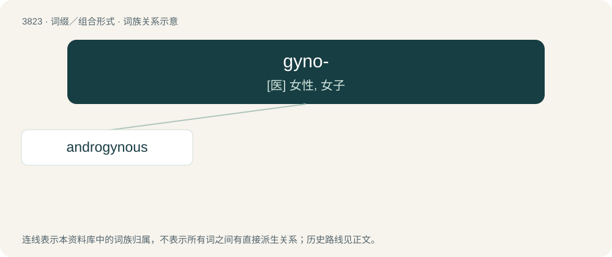

# 3854 · gyno- — \[医\] 女性, 女子

[总目录](../00_总目录_按常用程度.md)

**类型**：词缀／组合形式　｜　**来源语言**：见词源记录

## 核心含义与来源

- 核心含义：\[医\] 女性, 女子
- 英文含义：Of or pertaining to women.
- 词形：gyno-

## 词族图

## 单词速览（常用到不常用）

| 单词 | 音标 | 释义 |
|---|---|---|
| [androgynous](#w-1) | 英 /ænˈdɹɒd͡ʒ.ɪn.əs/；美 /ænˈdɹɑd͡ʒ.ən.əs/ | a. 雌雄同体的, 雌雄同序的, 两性畸形的；\[医\] 两性畸形的, 雌雄同体的, 男子女化的 |

## 逐词详解

### 1. androgynous

**词性**：形容词　｜　**音标**：英 /ænˈdɹɒd͡ʒ.ɪn.əs/；美 /ænˈdɹɑd͡ʒ.ən.əs/

**中文释义**：a. 雌雄同体的, 雌雄同序的, 两性畸形的；\[医\] 两性畸形的, 雌雄同体的, 男子女化的

**英文义项**：Possessing the sex organs of both sexes. / Pertaining to a feature or characteristic that is not definitively of either sex.

**构词拆分**：andro- + gyno- + -ous

**词源与演化**：

From Latin androgynus (“man-woman, hermaphrodite”), from Ancient Greek ἀνδρόγῠνος (andrógŭnos), from ἀνήρ (anḗr, “man”) + γῠνή (gŭnḗ, “woman”) + -ος (-os, “-ous”, adjectival suffix), equivalent to andro- + gyno- + -ous.

**例句**：

> Nicknames like Pat, Sam, and Chris are androgynous, used by both men and women.

该用例对应义项：Pertaining to a feature or characteristic that is not definitively of either sex.
