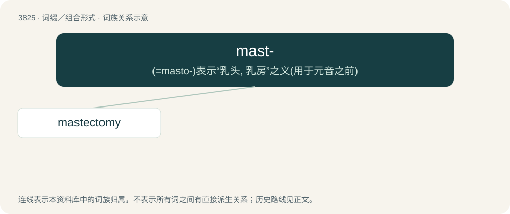

# 3855 · mast- — (=masto-)表示“乳头, 乳房”之义(用于元音之前)

[总目录](../00_总目录_按常用程度.md)

**类型**：词缀／组合形式　｜　**来源语言**：见词源记录

## 核心含义与来源

- 核心含义：(=masto-)表示“乳头, 乳房”之义(用于元音之前)
- 英文含义：mastoid process.
- 词形：mast-

**多个词源／构词路径**：同一拼写可能有不同来源；以下按词性和含义分别列出。

**来源记录 1**（前缀／前置成分；mastoid process.）

From Ancient Greek μάσταξ (mástax, “jaws, what chews”).

**来源记录 2**（前缀／前置成分；Relating to a breast or nipple.）

From Ancient Greek μαστός (mastós, “breast”).

## 词族图

## 单词速览（常用到不常用）

| 单词 | 音标 | 释义 |
|---|---|---|
| [mastectomy](#w-1) | /ˌmæsˈtɛktəmi/ | n. 乳房切除术；\[医\] 乳房切除术 |

## 逐词详解

### 1. mastectomy

**词性**：名词　｜　**音标**：/ˌmæsˈtɛktəmi/

**中文释义**：n. 乳房切除术；\[医\] 乳房切除术

**英文义项**：The surgical procedure to remove all or part of a breast and sometimes nearby tissues.

**构词拆分**：mast- + -ectomy

**词源与演化**：

From mast- + -ectomy.

**例句**：

> In comparison to mastectomy, lumpectomy removes a smaller percentage of breast tissue.
