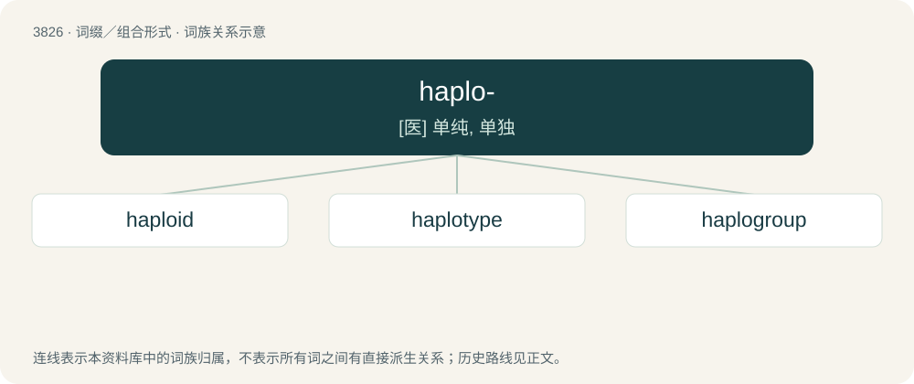

# 3858 · haplo- — \[医\] 单纯, 单独

[总目录](../00_总目录_按常用程度.md)

**类型**：词缀／组合形式　｜　**来源语言**：见词源记录

## 核心含义与来源

- 核心含义：\[医\] 单纯, 单独
- 英文含义：Haploid: having a single set of unpaired chromosomes.
- 词形：haplo-

## 词族图

## 单词速览（常用到不常用）

| 单词 | 音标 | 释义 |
|---|---|---|
| [haploid](#w-1) | /ˈhæplɔɪd/ | \[医\] 单倍体, 单倍的 |
| [haplotype](#w-2) | /ˈhap.lə(ʊ).taɪp/ | 单模标本 |
| [haplogroup](#w-3) |  | 【英文】A group of closely related haplotypes. |

## 逐词详解

### 1. haploid

**词性**：形容词　｜　**音标**：/ˈhæplɔɪd/

**中文释义**：\[医\] 单倍体, 单倍的

**英文义项**：Having the number of chromosomes that a typical gamete has (in the given organism), namely, half the number that a typical somatic cell has (in the given organism). / Having a single set of unpaired chromosomes (which is the number that a typical gamete has in many organisms although not all).

**构词拆分**：haplo- + -oid

**词源与演化**：

From haplo- + -oid, Ancient Greek roots meaning, together, literally “simplex” or “onefoldlike”, from ᾰ̔πλόος (hăplóos, “single, simple”, literally “onefold”) and -ειδής (-eidḗs, “-like”).

**例句**：

> Examples of haploid cells are prokaryotes and the gametes of eukaryotes.

该用例对应义项：Having a single set of unpaired chromosomes (which is the number that a typical gamete has in many organisms although not all).

### 2. haplotype

**词性**：名词　｜　**音标**：/ˈhap.lə(ʊ).taɪp/

**中文释义**：单模标本

**英文义项**：A haploid genotype: a group of alleles that are transmitted together.

**构词拆分**：haplo- + -type

**词源与演化**：

From haplo- + -type.

### 3. haplogroup

**词性**：名词

**英文义项**：A group of closely related haplotypes.

**构词拆分**：haplo- + group

**词源与演化**：

From haplo- + group.

**例句**：

> What's the haplogroup of North Africa's Berber populations?
