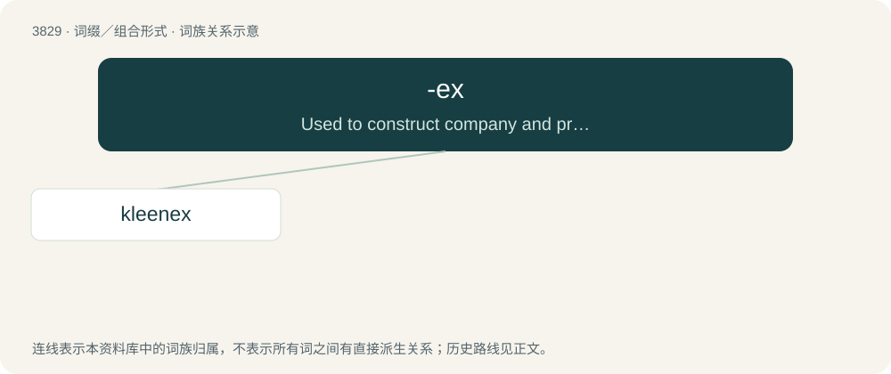

# 3861 · -ex — Used to construct company and product names that borrow meaning from the root word.

[总目录](../00_总目录_按常用程度.md)

**类型**：词缀／组合形式　｜　**来源语言**：见词源记录

## 核心含义与来源

- 核心含义：Used to construct company and product names that borrow meaning from the root word.
- 英文含义：Used to construct company and product names that borrow meaning from the root word.
- 词形：-ex

**来源记录 1**（后缀／后置成分；Used to construct company and product names that borrow meaning from the root word.）

Imitative of the ending of Latin-derived words such as index and codex

## 词族图

## 单词速览（常用到不常用）

| 单词 | 音标 | 释义 |
|---|---|---|
| [kleenex](#w-1) | /ˈkli.nɛks/ | 【英文】A disposable tissue. |

## 逐词详解

### 1. kleenex

**词性**：名词　｜　**音标**：/ˈkli.nɛks/

**英文义项**：A disposable tissue.

**构词拆分**：clean + -ex

**词源与演化**：

By genericization from the name of brand of tissues trademarked by Cellucotton Products Company (now Kimberly-Clark) in 1924–25. Alteration of clean + -ex.

**例句**：

> Could you hand me a kleenex? My nose is running.

该用例对应义项：A disposable tissue.
