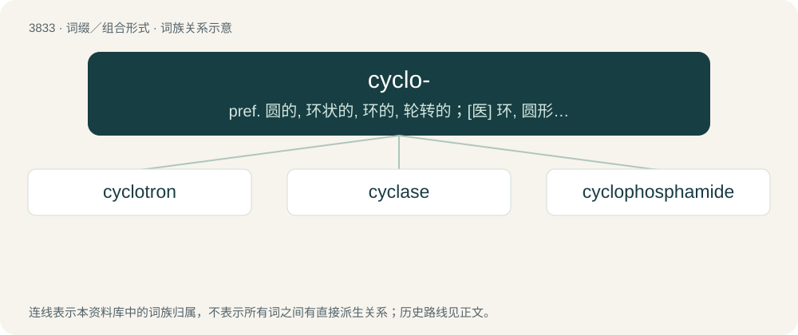

# 3864 · cyclo- — pref. 圆的, 环状的, 环的, 轮转的；\[医\] 环, 圆形; 睫状体

[总目录](../00_总目录_按常用程度.md)

**类型**：词缀／组合形式　｜　**来源语言**：见词源记录

## 核心含义与来源

- 核心含义：pref. 圆的, 环状的, 环的, 轮转的；\[医\] 环, 圆形; 睫状体
- 英文含义：Circle, circular.
- 词形：cyclo-

**来源记录 1**（前缀／前置成分；Circle, circular.）

From cycle, cyclic.

## 词族图

## 单词速览（常用到不常用）

| 单词 | 音标 | 释义 |
|---|---|---|
| [cyclotron](#w-1) | 英 /ˈsaɪ.klə.tɹɒn/；美 /ˈsaɪ.kləˌtɹɑn/ | n. 回旋加速器；\[化\] 回旋加速器 |
| [cyclase](#w-2) | /ˈsikleis/ | n. \[生化\]环化酶 |
| [cyclophosphamide](#w-3) | 英 /ˌsʌɪ.kləʊˈfɒs.fə.mʌɪd/；美 /ˌsaɪ.kloʊˈfɑs.fəˌmaɪd/ | \[化\] 环磷酰胺；\[医\] 环磷酰胺 |

## 逐词详解

### 1. cyclotron

**词性**：名词　｜　**音标**：英 /ˈsaɪ.klə.tɹɒn/；美 /ˈsaɪ.kləˌtɹɑn/

**中文释义**：n. 回旋加速器；\[化\] 回旋加速器

**英文义项**：An early particle accelerator in which charged particles were generated at a central source and accelerated spirally outward through a fixed magnetic field and alternating electric fields.

**构词拆分**：cyclo- + -tron

**词源与演化**：

From cyclo- + -tron.

### 2. cyclase

**词性**：名词　｜　**音标**：/ˈsikleis/

**中文释义**：n. \[生化\]环化酶

**英文义项**：Any enzyme that catalyzes the cyclization of a compound

**构词拆分**：cyclo- + -ase；cycle + -ase

**词源与演化**：

From cyclo- + -ase or cycle + -ase.

### 3. cyclophosphamide

**词性**：名词　｜　**音标**：英 /ˌsʌɪ.kləʊˈfɒs.fə.mʌɪd/；美 /ˌsaɪ.kloʊˈfɑs.fəˌmaɪd/

**中文释义**：\[化\] 环磷酰胺；\[医\] 环磷酰胺

**英文义项**：An immunosuppressive, antineoplastic drug used in the treatment of Hodgkin's disease and certain other forms of cancer.

**构词拆分**：cyclo- + phosphamide

**词源与演化**：

From cyclo- + phosphamide.
