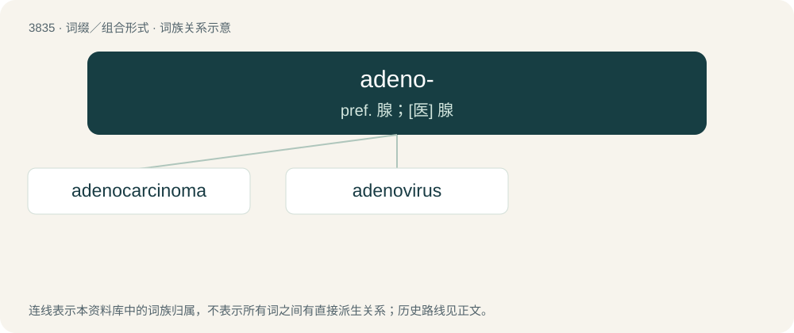

# 3866 · adeno- — pref. 腺；\[医\] 腺

[总目录](../00_总目录_按常用程度.md)

**类型**：词缀／组合形式　｜　**来源语言**：见词源记录

## 核心含义与来源

- 核心含义：pref. 腺；\[医\] 腺
- 英文含义：gland
- 词形：adeno-

**来源记录 1**（前缀／前置成分；gland）

From Ancient Greek ἀδήν (adḗn, “gland”).

## 词族图

## 单词速览（常用到不常用）

| 单词 | 音标 | 释义 |
|---|---|---|
| [adenocarcinoma](#w-1) | /ˈædinəu,kɑːsiˈnəumə/ | n. 腺癌；\[医\] 腺癌 |
| [adenovirus](#w-2) | /əˈdɛnəʊˌvaɪɹəs/ | n. 腺病毒；\[医\] 腺病毒 |

## 逐词详解

### 1. adenocarcinoma

**词性**：名词　｜　**音标**：/ˈædinəu,kɑːsiˈnəumə/

**中文释义**：n. 腺癌；\[医\] 腺癌

**英文义项**：Any of several forms of carcinoma that originate in glandular tissue.

**构词拆分**：adeno- + carcinoma

**词源与演化**：

From adeno- + carcinoma.

### 2. adenovirus

**词性**：名词　｜　**音标**：/əˈdɛnəʊˌvaɪɹəs/

**中文释义**：n. 腺病毒；\[医\] 腺病毒

**英文义项**：Any virus of the family Adenoviridae, many of which are responsible for respiratory infections in humans

**构词拆分**：adeno- + virus

**词源与演化**：

From adeno- + virus, after the human adenoid tissue from which it was isolated.
