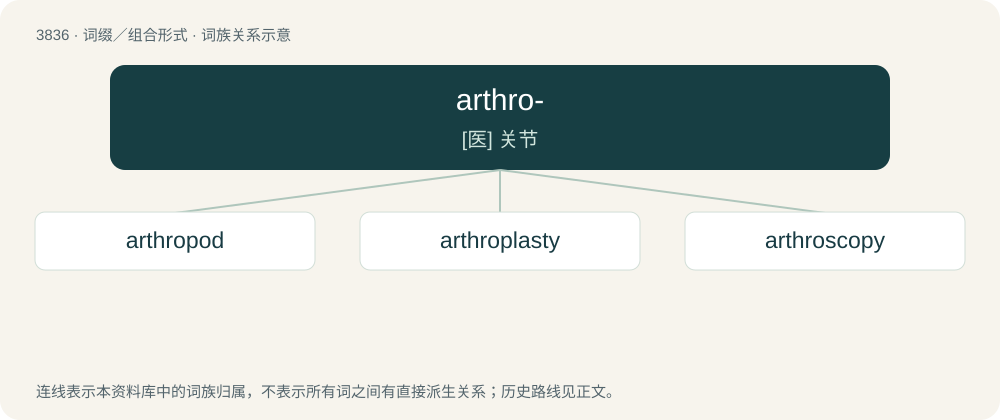

# 3867 · arthro- — \[医\] 关节

[总目录](../00_总目录_按常用程度.md)

**类型**：词缀／组合形式　｜　**来源语言**：见词源记录

## 核心含义与来源

- 核心含义：\[医\] 关节
- 英文含义：articulation = joint (as for example in arthroplasty).
- 词形：arthro-

**来源记录 1**（前缀／前置成分；articulation = joint (as for example in arthroplasty).）

From international scientific vocabulary, reflecting a New Latin combining form, from Ancient Greek ἄρθρον (árthron, “a joint”). By surface analysis, arthr- + -o-.

## 词族图

## 单词速览（常用到不常用）

| 单词 | 音标 | 释义 |
|---|---|---|
| [arthropod](#w-1) | /ˈɑːθɹəpɒd/ | n. 节肢动物；\[医\] 节肢动物 |
| [arthroplasty](#w-2) | /ˈɑːθrə,plæsti/ | \[医\] 关节成形术 |
| [arthroscopy](#w-3) | /ɑːˈθrɔskəpi/ | \[医\] 关节\[内窥\]镜检查 |

## 逐词详解

### 1. arthropod

**词性**：名词　｜　**音标**：/ˈɑːθɹəpɒd/

**中文释义**：n. 节肢动物；\[医\] 节肢动物

**英文义项**：An invertebrate animal of the phylum Arthropoda, characterized by a chitinous exoskeleton and multiple jointed appendages.

**构词拆分**：arthro- + -pod

**词源与演化**：

From New Latin Arthropoda, from Ancient Greek ἄρθρον (árthron, “joint”) + πούς (poús, “foot”), equivalent to arthro- + -pod.

**例句**：

> This little arthropod is more poisonous than you can imagine.

### 2. arthroplasty

**词性**：名词　｜　**音标**：/ˈɑːθrə,plæsti/

**中文释义**：\[医\] 关节成形术

**英文义项**：The surgical repair of a joint, or creation of an artificial joint, such as a hip replacement.

**构词拆分**：arthro- + -plasty

**词源与演化**：

From arthro- + -plasty.

### 3. arthroscopy

**词性**：名词　｜　**音标**：/ɑːˈθrɔskəpi/

**中文释义**：\[医\] 关节\[内窥\]镜检查

**英文义项**：the examination of the interior of a joint (such as the knee) using an arthroscope

**构词拆分**：arthro- + -scopy

**词源与演化**：

From arthro- + -scopy.
