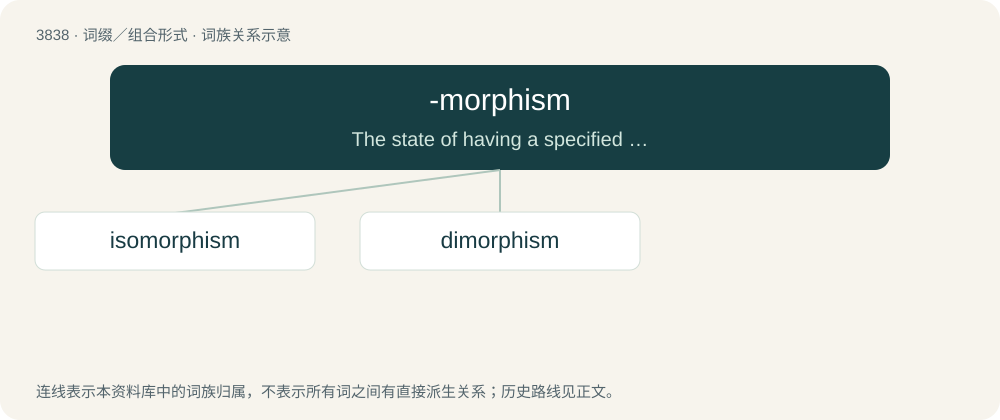

# 3870 · -morphism — The state of having a specified shape or form.

[总目录](../00_总目录_按常用程度.md)

**类型**：词缀／组合形式　｜　**来源语言**：见词源记录

## 核心含义与来源

- 核心含义：The state of having a specified shape or form.
- 英文含义：The state of having a specified shape or form.
- 词形：-morphism

**来源记录 1**（后缀／后置成分；The state of having a specified shape or form.）

From Ancient Greek μορφή (morphḗ, “form, shape”) + -ism, equivalent to -morph + -ism.

## 词族图

## 单词速览（常用到不常用）

| 单词 | 音标 | 释义 |
|---|---|---|
| [isomorphism](#w-1) | /ˌaɪsə(ʊ)ˈmɔɹfɪzəm/ | n. 同形, 类质同像；\[化\] 类质同晶 |
| [dimorphism](#w-2) | 英 /daɪˈmɔːfɪzəm/ | n. 同种二形, 二态性；\[化\] 双型; 双晶现象 |

## 逐词详解

### 1. isomorphism

**词性**：名词　｜　**音标**：/ˌaɪsə(ʊ)ˈmɔɹfɪzəm/

**中文释义**：n. 同形, 类质同像；\[化\] 类质同晶

**英文义项**：Similarity of form / the similarity in form of organisms, which may be due to convergent evolution or shared genetic background, e.g. an algae species in which the haploid and diploid life stages are indistinguishable based on morphology.

**构词拆分**：iso- + -morphism

**词源与演化**：

From iso- + -morphism.

**例句**：

> The diagram above commutes if and only if f is an isomorphism.

### 2. dimorphism

**词性**：名词　｜　**音标**：英 /daɪˈmɔːfɪzəm/

**中文释义**：n. 同种二形, 二态性；\[化\] 双型; 双晶现象

**英文义项**：The occurrence within a plant of two distinct forms of any part. / The occurrence in an animal species of two distinct types of individual.

**构词拆分**：di- + -morphism

**词源与演化**：

From di- + -morphism.

**例句**：

> Northern elephant seals are large and imposing, with significant differences in size and shape between sexes (sexual dimorphism).
