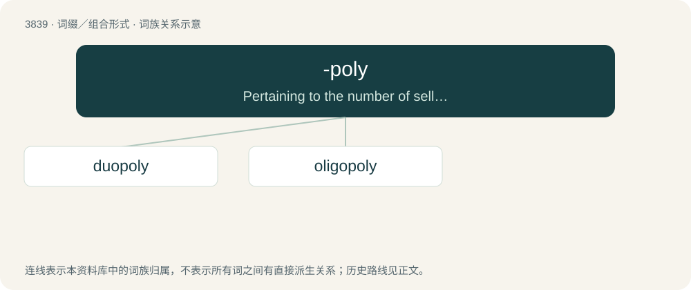

# 3871 · -poly — Pertaining to the number of sellers in a market.

[总目录](../00_总目录_按常用程度.md)

**类型**：词缀／组合形式　｜　**来源语言**：见词源记录

## 核心含义与来源

- 核心含义：Pertaining to the number of sellers in a market.
- 英文含义：Pertaining to the number of sellers in a market.
- 词形：-poly

**来源记录 1**（后缀／后置成分；Pertaining to the number of sellers in a market.）

Derived from the root of Ancient Greek πωλέω (pōléō, “I sell”), by analogy with monopoly. Unrelated to poly-.

## 词族图

## 单词速览（常用到不常用）

| 单词 | 音标 | 释义 |
|---|---|---|
| [duopoly](#w-1) | 英 /djuːˈɒpəli/；美 /duˈɑpəli/ | \[经\] 双头垄断的生产者 |
| [oligopoly](#w-2) | 英 /ɒlɪˈɡɒpəli/；美 /ˌɑləˈɡɑpəli/ | n. 求过于供的市场情况, 寡头买主垄断 |

## 逐词详解

### 1. duopoly

**词性**：名词　｜　**音标**：英 /djuːˈɒpəli/；美 /duˈɑpəli/

**中文释义**：\[经\] 双头垄断的生产者

**英文义项**：An economic condition in which two sellers exert most control over the market of a commodity. / The domination of a field of endeavour by two entities or people.

**构词拆分**：duo- (prefix meaning ‘two’) + -poly (suffix meaning ‘pertaining to the number of sellers in a market’)

**词源与演化**：

From duo- (prefix meaning ‘two’) + -poly (suffix meaning ‘pertaining to the number of sellers in a market’), by analogy with monopoly.

**例句**：

> First past the post voting has long maintained American politics as an effective duopoly where power simply alternates between two main parties.

该用例对应义项：The domination of a field of endeavour by two entities or people.

### 2. oligopoly

**词性**：名词　｜　**音标**：英 /ɒlɪˈɡɒpəli/；美 /ˌɑləˈɡɑpəli/

**中文释义**：n. 求过于供的市场情况, 寡头买主垄断

**英文义项**：An economic condition in which a small number of sellers exert control over the market of a commodity.

**构词拆分**：oligo- (prefix meaning ‘few; several’) + -poly (suffix meaning ‘pertaining to the number of sellers in a market’)

**词源与演化**：

From oligo- (prefix meaning ‘few; several’) + -poly (suffix meaning ‘pertaining to the number of sellers in a market’), by analogy with monopoly.

**例句**：

> An oligopoly is an imperfect monopoly.
