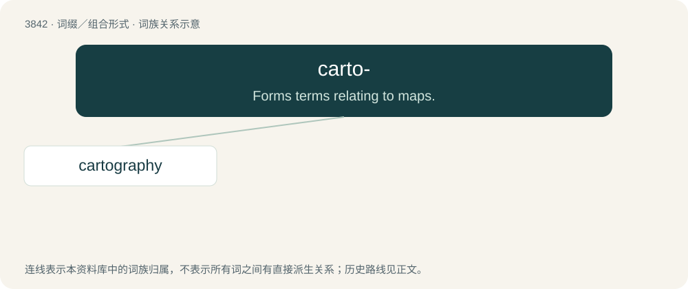

# 3873 · carto- — Forms terms relating to maps.

[总目录](../00_总目录_按常用程度.md)

**类型**：词缀／组合形式　｜　**来源语言**：见词源记录

## 核心含义与来源

- 核心含义：Forms terms relating to maps.
- 英文含义：Forms terms relating to maps.
- 词形：carto-

**来源记录 1**（前缀／前置成分；Forms terms relating to maps.）

From French carte or Italian carta + -o-.

## 词族图

## 单词速览（常用到不常用）

| 单词 | 音标 | 释义 |
|---|---|---|
| [cartography](#w-1) | 英 /kɑːˈtɒɡɹəfi/；美 /kɑɹˈtɑɡɹəfi/ | n. 地图制作, 制图学, 制图 |

## 逐词详解

### 1. cartography

**词性**：名词　｜　**音标**：英 /kɑːˈtɒɡɹəfi/；美 /kɑɹˈtɑɡɹəfi/

**中文释义**：n. 地图制作, 制图学, 制图

**英文义项**：The creation of charts and maps based on the layout of a territory's geography. / An illustrative discussion of a topic.

**构词拆分**：carto- (“map”) + -graphy

**词源与演化**：

From French cartographie, from carte (“map”) (ultimately from Ancient Greek χάρτης (khártēs, “map”)) + -graphie (“-graphy”) (from γράφω (gráphō, “write”)); carto- (“map”) + -graphy.

**例句**：

> The cartography department is responsible for creating detailed maps of the region.
