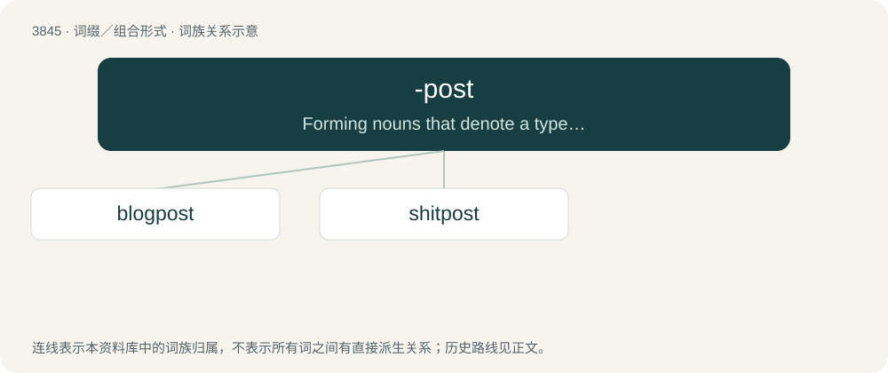

# 3875 · -post — Forming nouns that denote a type of Internet post.

[总目录](../00_总目录_按常用程度.md)

**类型**：词缀／组合形式　｜　**来源语言**：见词源记录

## 核心含义与来源

- 核心含义：Forming nouns that denote a type of Internet post.
- 英文含义：Forming nouns that denote a type of Internet post.
- 词形：-post

**来源记录 1**（后缀／后置成分；Forming nouns that denote a type of Internet post.）

From post.

## 词族图

## 单词速览（常用到不常用）

| 单词 | 音标 | 释义 |
|---|---|---|
| [blogpost](#w-1) |  | 【英文】To make a winding, diary-like post. |
| [shitpost](#w-2) | 英 /ˈʃɪtpəʊst/；美 /ˈʃɪtpoʊst/ | 【英文】A worthless or superficially meaningless post on a message board, newsgroup, or other online discussion platform, often intended to derail or distract from relevant conversation. |

## 逐词详解

### 1. blogpost

**词性**：动词

**英文义项**：To make a winding, diary-like post.

**构词拆分**：From blog + -post.

**词源与演化**：

From blog + -post.

### 2. shitpost

**词性**：名词　｜　**音标**：英 /ˈʃɪtpəʊst/；美 /ˈʃɪtpoʊst/

**英文义项**：A worthless or superficially meaningless post on a message board, newsgroup, or other online discussion platform, often intended to derail or distract from relevant conversation. / A seemingly worthless or superficially meaningless image, video or piece of text posted to a social media platform that is intended to be humorously or ironically enjoyed.

**构词拆分**：shit + -post

**词源与演化**：

From shit + -post.

**例句**：

> Tom loves to shitpost in his spare time.
