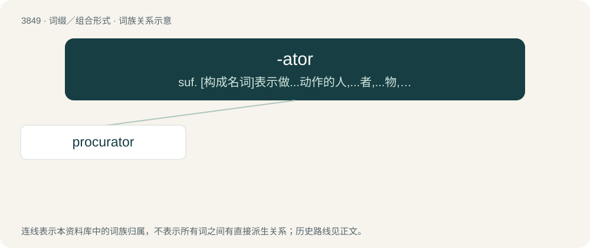

# 3877 · -ator — suf. \[构成名词\]表示做...动作的人,...者,...物,起...作用的物：improvisator,cinerator

[总目录](../00_总目录_按常用程度.md)

**类型**：词缀／组合形式　｜　**来源语言**：见词源记录

## 核心含义与来源

- 核心含义：suf. \[构成名词\]表示做...动作的人,...者,...物,起...作用的物：improvisator,cinerator
- 英文含义：Used to form agent nouns, usually from verbs that have the ending -ate.
- 词形：-ator

**来源记录 1**（后缀／后置成分；Used to form agent nouns, usually from verbs that have the ending -ate.）

Borrowed from Latin -ātor or -ate + -or.

## 词族图

## 单词速览（常用到不常用）

| 单词 | 音标 | 释义 |
|---|---|---|
| [procurator](#w-1) | 英 /ˈpɹɒkjʊˌɹeɪtə/；美 /ˈpɹɑkjəˌɹeɪtɚ/ | n. 代理人, 行政长官, 检察官；\[经\] 代理人, 受托人 |

## 逐词详解

### 1. procurator

**词性**：名词　｜　**音标**：英 /ˈpɹɒkjʊˌɹeɪtə/；美 /ˈpɹɑkjəˌɹeɪtɚ/

**中文释义**：n. 代理人, 行政长官, 检察官；\[经\] 代理人, 受托人

**英文义项**：A tax collector. / An agent or attorney.

**构词拆分**：procure + -ator

**词源与演化**：

Inherited from Middle English procuratour, from Anglo-Norman procuratour, from Latin prōcūrātor, from prōcūrō (“to procure”) (English procure). Equivalent to procure + -ator and a doublet of proctor and procurer.
