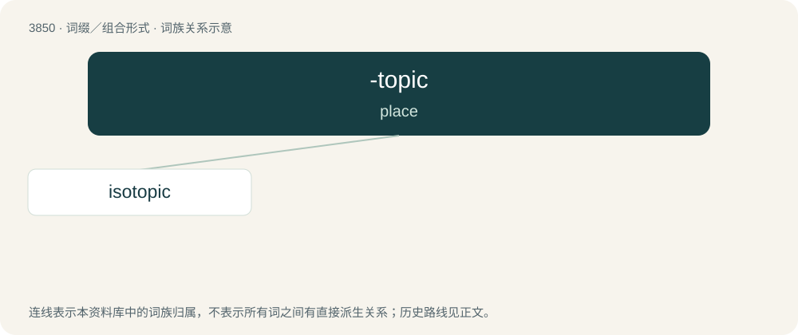

# 3878 · -topic — place

[总目录](../00_总目录_按常用程度.md)

**类型**：词缀／组合形式　｜　**来源语言**：见词源记录

## 核心含义与来源

- 核心含义：place
- 英文含义：place
- 词形：-topic

**来源记录 1**（后缀／后置成分；place）

From Latin topica, from Ancient Greek τοπικός (topikós, “pertaining to a place, local, pertaining to a common place, or topic, topical”), from τόπος (tópos, “a place”); equivalent to -topia + -ic.

## 词族图

## 单词速览（常用到不常用）

| 单词 | 音标 | 释义 |
|---|---|---|
| [isotopic](#w-1) | /,aisəuˈtɔpik/ | 【英文】Of two presemifields 𝕊 and 𝕊' of characteristic p, when there exists three linear maps g\_1, g\_2, and g\_3 from 𝕊 to 𝕊' such that g\_1(x·y)=g\_2(x)∘g\_3(y) for all x,y∈𝕊. |

## 逐词详解

### 1. isotopic

**词性**：形容词　｜　**音标**：/,aisəuˈtɔpik/

**英文义项**：Of two presemifields 𝕊 and 𝕊' of characteristic p, when there exists three linear maps g\_1, g\_2, and g\_3 from 𝕊 to 𝕊' such that g\_1(x·y)=g\_2(x)∘g\_3(y) for all x,y∈𝕊.

**构词拆分**：iso- + -topic

**词源与演化**：

From iso- + -topic.
