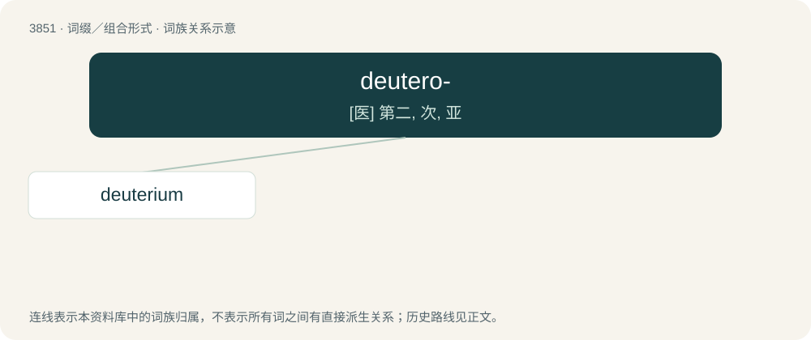

# 3879 · deutero- — \[医\] 第二, 次, 亚

[总目录](../00_总目录_按常用程度.md)

**类型**：词缀／组合形式　｜　**来源语言**：见词源记录

## 核心含义与来源

- 核心含义：\[医\] 第二, 次, 亚
- 英文含义：Second or secondary.
- 词形：deutero-

**来源记录 1**（前缀／前置成分；Second or secondary.）

From Ancient Greek δεύτερος (deúteros, “second (of two)”).

## 词族图

## 单词速览（常用到不常用）

| 单词 | 音标 | 释义 |
|---|---|---|
| [deuterium](#w-1) | 英 /djuːˈtɪəɹɪəm/；美 /djuːˈtɪɹi.əm/ | n. 氘, 重氢；\[化\] 氘; 重氢 |

## 逐词详解

### 1. deuterium

**词性**：名词　｜　**音标**：英 /djuːˈtɪəɹɪəm/；美 /djuːˈtɪɹi.əm/

**中文释义**：n. 氘, 重氢；\[化\] 氘; 重氢

**英文义项**：An isotope of hydrogen with one proton and one neutron in each atom - 21H. / An atom of this isotope.

**构词拆分**：deutero- + -ium

**词源与演化**：

From deutero- + -ium. Coined by American physical chemist Harold Urey, from Ancient Greek δεύτερος (deúteros, “second”).

**例句**：

> There were about 80 deuteriums for every million protiums, and virtually no tritium.

该用例对应义项：An atom of this isotope.
