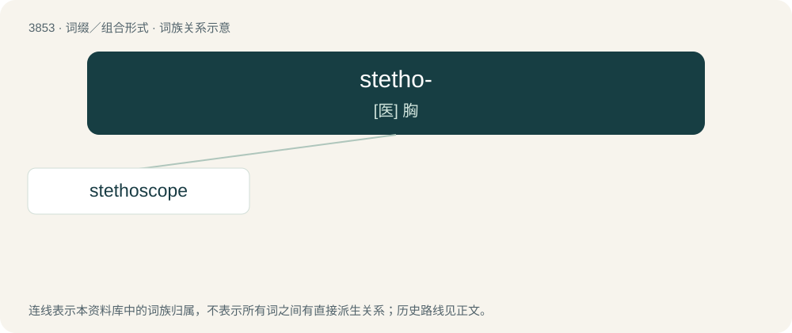

# 3881 · stetho- — \[医\] 胸

[总目录](../00_总目录_按常用程度.md)

**类型**：词缀／组合形式　｜　**来源语言**：见词源记录

## 核心含义与来源

- 核心含义：\[医\] 胸
- 英文含义：chest
- 词形：stetho-

**来源记录 1**（前缀／前置成分；chest）

From Ancient Greek στῆθος (stêthos).

## 词族图

## 单词速览（常用到不常用）

| 单词 | 音标 | 释义 |
|---|---|---|
| [stethoscope](#w-1) | 英 /ˈstɛθəskəʊp/；美 /ˈstɛθəsˌkoʊp/ | n. 听诊器；vt. 用听诊器诊断 |

## 逐词详解

### 1. stethoscope

**词性**：名词　｜　**音标**：英 /ˈstɛθəskəʊp/；美 /ˈstɛθəsˌkoʊp/

**中文释义**：n. 听诊器；vt. 用听诊器诊断

**英文义项**：A medical instrument used for listening to sounds produced within the body.

**构词拆分**：stetho- + -scope

**词源与演化**：

Borrowed from French stéthoscope, a word coined by its inventor, physician René Laennec, equivalent to stetho- + -scope.

**例句**：

> The doctor is listening to the patient's lungs using a stethoscope.
