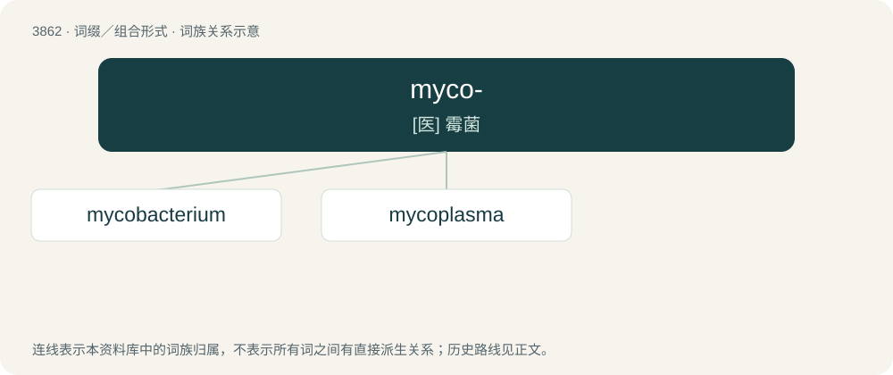

# 3889 · myco- — \[医\] 霉菌

[总目录](../00_总目录_按常用程度.md)

**类型**：词缀／组合形式　｜　**来源语言**：见词源记录

## 核心含义与来源

- 核心含义：\[医\] 霉菌
- 英文含义：Relating to fungi.
- 词形：myco-

**来源记录 1**（前缀／前置成分；Relating to fungi.）

From Ancient Greek μῠ́κης (mŭ́kēs, “mushroom or other fungus”) + English -o-.

## 词族图

## 单词速览（常用到不常用）

| 单词 | 音标 | 释义 |
|---|---|---|
| [mycobacterium](#w-1) |  | 【英文】Any of many rod-shaped, aerobic bacteria, of the genus Mycobacterium, that cause diseases such as tuberculosis and leprosy. |
| [mycoplasma](#w-2) | /,maikəuˈplæzmə/ | n. \[微\]支原体,支原菌 |

## 逐词详解

### 1. mycobacterium

**词性**：名词

**英文义项**：Any of many rod-shaped, aerobic bacteria, of the genus Mycobacterium, that cause diseases such as tuberculosis and leprosy.

**构词拆分**：myco- + bacterium

**词源与演化**：

From myco- + bacterium.

### 2. mycoplasma

**词性**：名词　｜　**音标**：/,maikəuˈplæzmə/

**中文释义**：n. \[微\]支原体,支原菌

**英文义项**：Any infectious bacterium of the genus Mycoplasma, often specifically Mycoplasma pneumoniae

**构词拆分**：myco- + plasma

**词源与演化**：

From translingual Mycoplasma, from Latin, from Ancient Greek μύκης (múkēs, “fungus”) + πλάσμα (plásma, “-shaped”). Equivalent to myco- + plasma.
