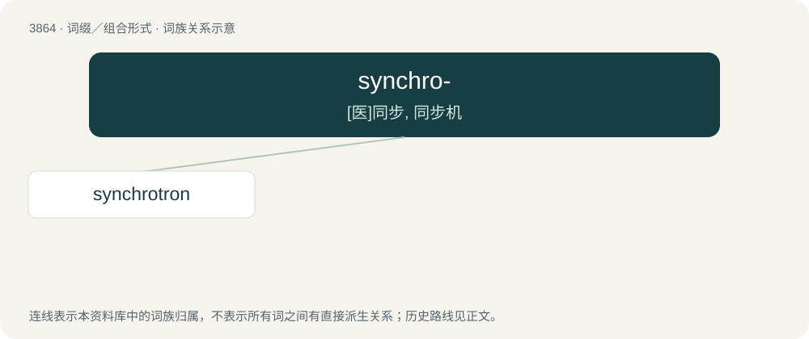

# 3891 · synchro- — \[医\]同步, 同步机

[总目录](../00_总目录_按常用程度.md)

**类型**：词缀／组合形式　｜　**来源语言**：见词源记录

## 核心含义与来源

- 核心含义：\[医\]同步, 同步机
- 英文含义：synchronous; synchronized
- 词形：synchro-

**来源记录 1**（前缀／前置成分；synchronous; synchronized）

Analyzable as syn- + chrono-, from Ancient Greek σύν (sún)+χρόνος (khrónos)

## 词族图

## 单词速览（常用到不常用）

| 单词 | 音标 | 释义 |
|---|---|---|
| [synchrotron](#w-1) | /ˈsɪŋkɹə(ʊ)tɹɒn/ | n. 同步加速器；\[化\] 同步加速器 |

## 逐词详解

### 1. synchrotron

**词性**：名词　｜　**音标**：/ˈsɪŋkɹə(ʊ)tɹɒn/

**中文释义**：n. 同步加速器；\[化\] 同步加速器

**英文义项**：A form of cyclotron in which charged particles are accelerated by an electric field that is synchronized with a magnetic field that keeps them in a circular path.

**构词拆分**：synchro- + -tron

**词源与演化**：

From synchro- + -tron.
