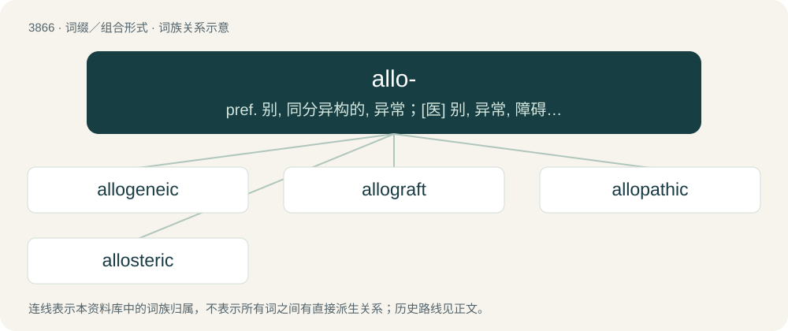

# 3894 · allo- — pref. 别, 同分异构的, 异常；\[医\] 别, 异常, 障碍, 倒错, 错

[总目录](../00_总目录_按常用程度.md)

**类型**：词缀／组合形式　｜　**来源语言**：见词源记录

## 核心含义与来源

- 核心含义：pref. 别, 同分异构的, 异常；\[医\] 别, 异常, 障碍, 倒错, 错
- 英文含义：Nonself; nonself but of the same species.
- 词形：allo-

**来源记录 1**（前缀／前置成分；Nonself; nonself but of the same species.）

From Ancient Greek ἄλλος (állos, “other”), from Proto-Hellenic \*ál͏̌l͏̌os, from Proto-Indo-European \*h₂élyos (English else).

## 词族图

## 单词速览（常用到不常用）

| 单词 | 音标 | 释义 |
|---|---|---|
| [allogeneic](#w-1) | /ˌæləd͡ʒəˈniɪk/ | a. 同种异体的, 同种组织移植的；\[化\] 同种异基因的 |
| [allograft](#w-2) | 英 /ˈæləʊˌɡɹɑːft/；美 /ˈæloʊˌɡɹæft/ | n. 同种移植物 |
| [allopathic](#w-3) | 美 /ˌæl.oʊˈpæθ.ɪk/ | a. 对抗疗法的；\[医\] 对抗疗法的 |
| [allosteric](#w-4) | /,æləˈsterik/ | a. \[生化\]变构(象)的 |

## 逐词详解

### 1. allogeneic

**词性**：形容词　｜　**音标**：/ˌæləd͡ʒəˈniɪk/

**中文释义**：a. 同种异体的, 同种组织移植的；\[化\] 同种异基因的

**英文义项**：Genetically different because of being derived from separate individuals of the same species. / Of a reaction that occurs when cells are transplanted into a genetically different recipient.

**构词拆分**：allo- + -gene- + -ic

**词源与演化**：

From allo- + -gene- + -ic.

### 2. allograft

**词性**：名词　｜　**音标**：英 /ˈæləʊˌɡɹɑːft/；美 /ˈæloʊˌɡɹæft/

**中文释义**：n. 同种移植物

**英文义项**：A surgical transplant of tissue between genetically different individuals of the same species.

**构词拆分**：allo- + graft

**词源与演化**：

From allo- + graft.

### 3. allopathic

**词性**：形容词　｜　**音标**：美 /ˌæl.oʊˈpæθ.ɪk/

**中文释义**：a. 对抗疗法的；\[医\] 对抗疗法的

**英文义项**：Of or pertaining to allopathy.

**构词拆分**：allo- + -pathic

**词源与演化**：

From allo- + -pathic.

### 4. allosteric

**词性**：形容词　｜　**音标**：/,æləˈsterik/

**中文释义**：a. \[生化\]变构(象)的

**英文义项**：That binds a compound on an inactive site and thus changes macromolecular conformation or dynamics in order to become either active or inactive

**构词拆分**：allo- (“other”) + -steric

**词源与演化**：

From allo- (“other”) + -steric.
