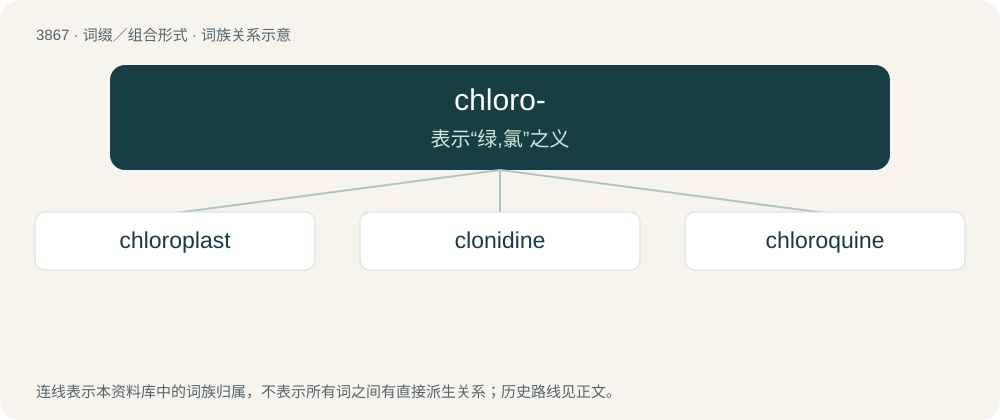

# 3895 · chloro- — 表示“绿,氯”之义

[总目录](../00_总目录_按常用程度.md)

**类型**：词缀／组合形式　｜　**来源语言**：见词源记录

## 核心含义与来源

- 核心含义：表示“绿,氯”之义
- 英文含义：green in color.
- 词形：chloro-

**来源记录 1**（前缀／前置成分；green in color.）

From Ancient Greek χλωρός (khlōrós, “pale green”).

## 词族图

## 单词速览（常用到不常用）

| 单词 | 音标 | 释义 |
|---|---|---|
| [chloroplast](#w-1) | /ˈklɔːɹəʊˌplæst/ | n. 叶绿体；\[医\] 叶绿粒 |
| [clonidine](#w-2) | 英 /ˈklɒn.ɪd.iːn/；美 /ˈklɑn.əˌdiːn/ | \[化\] 可乐定 |
| [chloroquine](#w-3) | 英 /ˈklɔː.ɹə(ʊ).kwiːn/；美 /ˈklɔɹ.əˌkwɪn/ | n. 氯奎, 氯喹；\[化\] 氯喹 |

## 逐词详解

### 1. chloroplast

**词性**：名词　｜　**音标**：/ˈklɔːɹəʊˌplæst/

**中文释义**：n. 叶绿体；\[医\] 叶绿粒

**英文义项**：An organelle, found in the cells of green plants and in photosynthetic algae, where photosynthesis takes place, characterized by a high concentration of chlorophyll and two membranes.

**构词拆分**：chloro- + -plast

**词源与演化**：

From chloro- + -plast.

**例句**：

> The mitochondria and chloroplast were originally prokaryotes.

### 2. clonidine

**词性**：名词　｜　**音标**：英 /ˈklɒn.ɪd.iːn/；美 /ˈklɑn.əˌdiːn/

**中文释义**：\[化\] 可乐定

**英文义项**：A drug that acts as an α₂-adrenoreceptor agonist, used in the treatment of hypertension, opiate withdrawal, and a variety of other conditions.

**构词拆分**：chlo(ro)- + -(gua)nidine

**词源与演化**：

From chlo(ro)- + -(gua)nidine.

### 3. chloroquine

**词性**：名词　｜　**音标**：英 /ˈklɔː.ɹə(ʊ).kwiːn/；美 /ˈklɔɹ.əˌkwɪn/

**中文释义**：n. 氯奎, 氯喹；\[化\] 氯喹

**英文义项**：A 4-aminoquinoline drug used to treat and prevent malaria, having the chemical formula C₁₈H₂₆ClN₃.

**构词拆分**：chloro- + -quine

**词源与演化**：

From chloro- + -quine (“quinoline derivative”).

**例句**：

> Nigeria has warned against using the drug chloroquine to fight COVID-19 after three people were hospitalized after overdosing on it.
