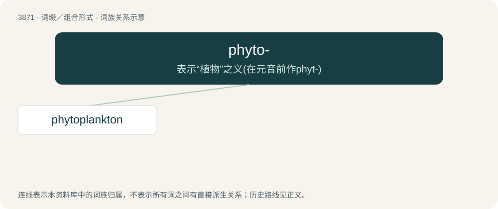

# 3900 · phyto- — 表示“植物”之义(在元音前作phyt-)

[总目录](../00_总目录_按常用程度.md)

**类型**：词缀／组合形式　｜　**来源语言**：见词源记录

## 核心含义与来源

- 核心含义：表示“植物”之义(在元音前作phyt-)
- 英文含义：Pertaining to or derived from plants.
- 词形：phyto-

**来源记录 1**（前缀／前置成分；Pertaining to or derived from plants.）

Derived from Ancient Greek φῠτόν (phŭtón, “plant”).

## 词族图

## 单词速览（常用到不常用）

| 单词 | 音标 | 释义 |
|---|---|---|
| [phytoplankton](#w-1) | 英 /ˌfaɪ.təˈplæŋk.tən/；美 /ˌfaɪ.təˈplæŋk.tən/ | n. 浮游植物；\[医\] 浮游植物 |

## 逐词详解

### 1. phytoplankton

**词性**：名词　｜　**音标**：英 /ˌfaɪ.təˈplæŋk.tən/；美 /ˌfaɪ.təˈplæŋk.tən/

**中文释义**：n. 浮游植物；\[医\] 浮游植物

**英文义项**：Plankton, especially those small in size, that obtain energy by photosynthesis.

**构词拆分**：phyto- + plankton

**词源与演化**：

From phyto- + plankton. From Ancient Greek φυτόν (phutón, “plant”) + πλαγκτόν (planktón), neuter of πλαγκτός (planktós, “wandering”). However, they are no longer classified as plants, so the terminology is showing a historical meaning.

**例句**：

> About two-thirds of the Earth's oxygen is produced by phytoplankton.
