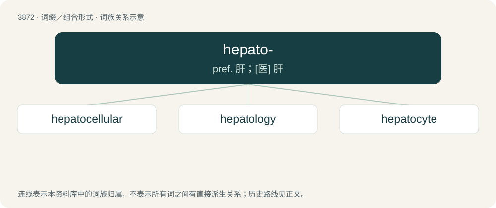

# 3901 · hepato- — pref. 肝；\[医\] 肝

[总目录](../00_总目录_按常用程度.md)

**类型**：词缀／组合形式　｜　**来源语言**：见词源记录

## 核心含义与来源

- 核心含义：pref. 肝；\[医\] 肝
- 英文含义：Pertaining to the liver.
- 词形：hepato-

**来源记录 1**（前缀／前置成分；Pertaining to the liver.）

From Ancient Greek ἠπᾰτ- (ēpăt-), the stem of ἧπᾰρ (hêpăr, “liver”); compare hepar.

## 词族图

## 单词速览（常用到不常用）

| 单词 | 音标 | 释义 |
|---|---|---|
| [hepatocellular](#w-1) | /,hepətəuˈseljulə/ | a. 肝细胞的；\[医\] 肝细胞的 |
| [hepatology](#w-2) | /,hepəˈtɔlədʒi/ | 肝脏病学, 肝脏学 |
| [hepatocyte](#w-3) | /ˈhepətəsait/ | n. 肝细胞 |

## 逐词详解

### 1. hepatocellular

**词性**：形容词　｜　**音标**：/,hepətəuˈseljulə/

**中文释义**：a. 肝细胞的；\[医\] 肝细胞的

**英文义项**：Of or pertaining to the cells of the liver

**构词拆分**：hepato- + cellular

**词源与演化**：

From hepato- + cellular.

### 2. hepatology

**词性**：名词　｜　**音标**：/,hepəˈtɔlədʒi/

**中文释义**：肝脏病学, 肝脏学

**英文义项**：The study or treatment of the liver, gallbladder, and pancreas.

**构词拆分**：hepato- + -logy

**词源与演化**：

From hepato- + -logy.

### 3. hepatocyte

**词性**：名词　｜　**音标**：/ˈhepətəsait/

**中文释义**：n. 肝细胞

**英文义项**：Any of the cells in the liver responsible for the metabolism of protein, carbohydrate and lipid and for detoxification.

**构词拆分**：hepato- + -cyte

**词源与演化**：

From hepato- + -cyte.
