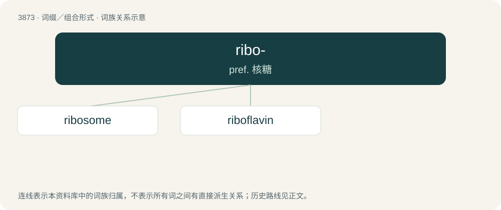

# 3902 · ribo- — pref. 核糖

[总目录](../00_总目录_按常用程度.md)

**类型**：词缀／组合形式　｜　**来源语言**：见词源记录

## 核心含义与来源

- 核心含义：pref. 核糖
- 英文含义：ribose
- 词形：ribo-

## 词族图

## 单词速览（常用到不常用）

| 单词 | 音标 | 释义 |
|---|---|---|
| [ribosome](#w-1) | 英 /ˈɹaɪbəˌsəʊm/；美 /ˈɹaɪbəˌsoʊm/ | n. 核糖体；\[化\] 核蛋白体; 核糖核蛋白体; 核糖体 |
| [riboflavin](#w-2) | /ˌraɪboʊˈfleɪvɪn/ | n. 核黄素；\[化\] 核黄素; 维生素B-2 |

## 逐词详解

### 1. ribosome

**词性**：名词　｜　**音标**：英 /ˈɹaɪbəˌsəʊm/；美 /ˈɹaɪbəˌsoʊm/

**中文释义**：n. 核糖体；\[化\] 核蛋白体; 核糖核蛋白体; 核糖体

**英文义项**：A small organelle found in all cells; involved in the production of proteins by translating messenger RNA.

**构词拆分**：ribo- + -some

**词源与演化**：

From ribo- + -some.

**例句**：

> The ribosome is the site of protein synthesis.

该用例对应义项：an organelle in the cytoplasm of a living cell; they attach to mRNA and move down it one codon at a time and then stop until tRNA brings the required amino acid; when it reaches a stop codon it falls apart and releases the completed protein molecule for use by the cell

### 2. riboflavin

**词性**：名词　｜　**音标**：/ˌraɪboʊˈfleɪvɪn/

**中文释义**：n. 核黄素；\[化\] 核黄素; 维生素B-2

**英文义项**：Yellow or orange-yellow water-soluble compound, a member of the vitamin B complex, that acts as a growth-promoting factor in humans and other animals.

**构词拆分**：From ribo(se)- + flavin.

**词源与演化**：

From ribo(se)- + flavin.
