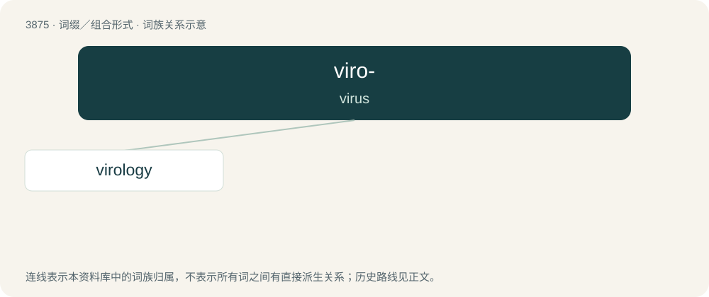

# 3904 · viro- — virus

[总目录](../00_总目录_按常用程度.md)

**类型**：词缀／组合形式　｜　**来源语言**：见词源记录

## 核心含义与来源

- 核心含义：virus
- 英文含义：virus
- 词形：viro-

## 词族图

## 单词速览（常用到不常用）

| 单词 | 音标 | 释义 |
|---|---|---|
| [virology](#w-1) | /vaɪˈɹɒləd͡ʒi/ | n. 病毒学；\[医\] 病毒学 |

## 逐词详解

### 1. virology

**词性**：名词　｜　**音标**：/vaɪˈɹɒləd͡ʒi/

**中文释义**：n. 病毒学；\[医\] 病毒学

**英文义项**：The branch of microbiology that deals with the study of viruses and viral diseases.

**构词拆分**：viro- + -logy

**词源与演化**：

From viro- + -logy.

**例句**：

> The Wuhan virology institute was only studying viruses that came directly from bats.
