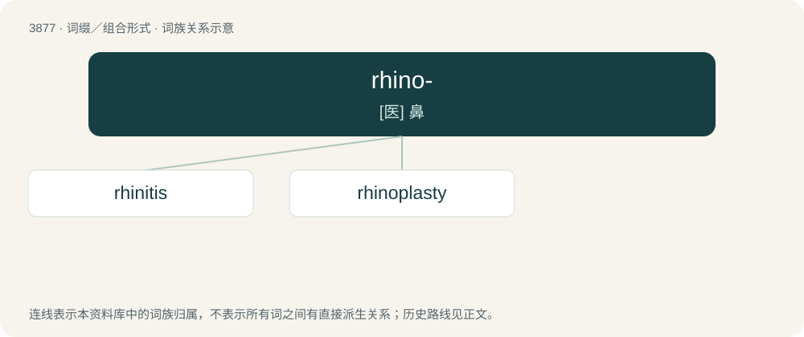

# 3905 · rhino- — \[医\] 鼻

[总目录](../00_总目录_按常用程度.md)

**类型**：词缀／组合形式　｜　**来源语言**：见词源记录

## 核心含义与来源

- 核心含义：\[医\] 鼻
- 英文含义：Of the nose.
- 词形：rhino-

**来源记录 1**（前缀／前置成分；Of the nose.）

From Ancient Greek ῥῑνο- (rhīno-), combining form of ῥῑ́ς (rhī́s, “nose”)

## 词族图

## 单词速览（常用到不常用）

| 单词 | 音标 | 释义 |
|---|---|---|
| [rhinitis](#w-1) | /ɹaɪˈnaɪtɪs/ | n. 鼻炎；\[医\] 鼻炎 |
| [rhinoplasty](#w-2) | /ˈrainəplæsti/ | n. 鼻整形术；\[医\] 鼻成形术 |

## 逐词详解

### 1. rhinitis

**词性**：名词　｜　**音标**：/ɹaɪˈnaɪtɪs/

**中文释义**：n. 鼻炎；\[医\] 鼻炎

**英文义项**：Inflammation of the mucous membranes of the nose. / cold; common cold.

**构词拆分**：rhin- + -itis

**词源与演化**：

From rhin- + -itis.

**例句**：

> Every time summer ends and autumn begins, my rhinitis starts playing up.

### 2. rhinoplasty

**词性**：名词　｜　**音标**：/ˈrainəplæsti/

**中文释义**：n. 鼻整形术；\[医\] 鼻成形术

**英文义项**：A type of plastic surgery that is used to improve the function (reconstructive surgery) or appearance (cosmetic surgery) of a person's nose. / An instance of such surgery; one operation (procedure).

**构词拆分**：rhino- + -plasty

**词源与演化**：

From rhino- + -plasty.

**例句**：

> Martha wanted a rhinoplasty and lip augmentation.
