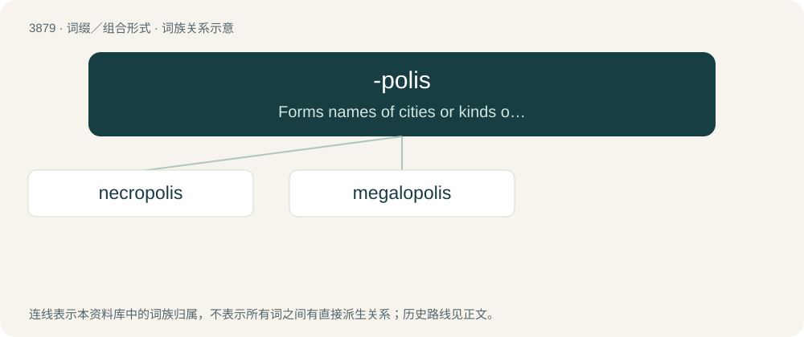

# 3907 · -polis — Forms names of cities or kinds of cities.

[总目录](../00_总目录_按常用程度.md)

**类型**：词缀／组合形式　｜　**来源语言**：见词源记录

## 核心含义与来源

- 核心含义：Forms names of cities or kinds of cities.
- 英文含义：Forms names of cities or kinds of cities.
- 词形：-polis

## 词族图

## 单词速览（常用到不常用）

| 单词 | 音标 | 释义 |
|---|---|---|
| [necropolis](#w-1) | 英 /nɛˈkɹɒpəlɪs/；美 /nɛˈkɹɑpələs/ | n. 大墓地, 史前坟场 |
| [megalopolis](#w-2) | /mɛ.ɡəˈlɒ.pə.lɪs/ | n. 特大都市, 人口稠密地带 |

## 逐词详解

### 1. necropolis

**词性**：名词　｜　**音标**：英 /nɛˈkɹɒpəlɪs/；美 /nɛˈkɹɑpələs/

**中文释义**：n. 大墓地, 史前坟场

**英文义项**：A cemetery; especially a large one in or near a city. / An ancient site used for burying the dead, particularly if consisting of elaborate grave monuments.

**构词拆分**：necro- + -polis

**词源与演化**：

Borrowed from Koine Greek νεκρόπολις (nekrópolis, “city of the dead, cemetery”) (used to describe part of the city of Alexandria, Egypt), from Ancient Greek νεκρός (nekrós, “dead”) (ultimately from Proto-Indo-European \*neḱ- (“to disappear; to perish”)) + πόλις (pólis, “city”) (ultimately from Proto-Indo-European \*tpelH- (“city; fortification”)). The English word is analysable as necro- + -polis, and is cognate with French nécropole, German Nekropolis, Late Latin necropolis. The plural form necropoleis is derived from Ancient Greek νεκροπόλεις (nekropóleis).

**例句**：

> Thirteen completely sealed wooden coffins have been discovered in the necropolis of Saqqara in Egypt.

### 2. megalopolis

**词性**：名词　｜　**音标**：/mɛ.ɡəˈlɒ.pə.lɪs/

**中文释义**：n. 特大都市, 人口稠密地带

**英文义项**：A large conurbation, where two or more large cities have sprawled outward to meet, forming something larger than a normal metropolis.

**构词拆分**：megalo- (“great”) + -polis (“city”)

**词源与演化**：

From megalo- (“great”) + -polis (“city”).

**例句**：

> The Eastern Seaboard megalopolis extends from New Hampshire to Alexandria, VA.

该用例对应义项：A large conurbation, where two or more large cities have sprawled outward to meet, forming something larger than a normal metropolis.
