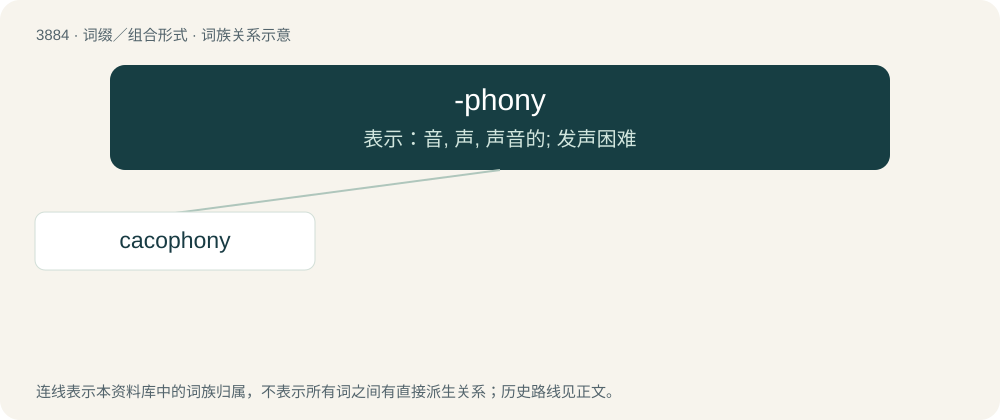

# 3910 · -phony — 表示：音, 声, 声音的; 发声困难

[总目录](../00_总目录_按常用程度.md)

**类型**：词缀／组合形式　｜　**来源语言**：见词源记录

## 核心含义与来源

- 核心含义：表示：音, 声, 声音的; 发声困难
- 英文含义：sound or its production
- 词形：-phony

**来源记录 1**（后缀／后置成分；sound or its production）

From French -phonie, from Old French -phonie, and its etymon Classical Latin -phōnia, from Ancient Greek -φωνία (-phōnía). By surface analysis, -phone + -y. Doublet of -phonia.

## 词族图

## 单词速览（常用到不常用）

| 单词 | 音标 | 释义 |
|---|---|---|
| [cacophony](#w-1) | 英 /kəˈkɒfəni/；美 /kəˈkɑfəni/ | n. 不愉快的音调, 不协和音, 杂音 |

## 逐词详解

### 1. cacophony

**词性**：名词　｜　**音标**：英 /kəˈkɒfəni/；美 /kəˈkɑfəni/

**中文释义**：n. 不愉快的音调, 不协和音, 杂音

**英文义项**：A mix of discordant sounds; dissonance.

**构词拆分**：caco- + -phony

**词源与演化**：

From French cacophonie, from Ancient Greek κακοφωνία (kakophōnía), from κακός (kakós, “bad”) + φωνή (phōnḗ, “sound”), equivalent to caco- + -phony.

**例句**：

> There's a cacophony coming from the building site across the road.
