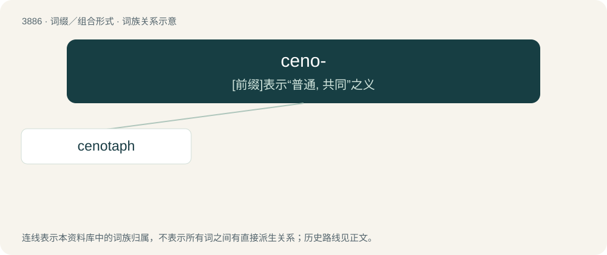

# 3913 · ceno- — \[前缀\]表示“普通, 共同”之义

[总目录](../00_总目录_按常用程度.md)

**类型**：词缀／组合形式　｜　**来源语言**：见词源记录

## 核心含义与来源

- 核心含义：\[前缀\]表示“普通, 共同”之义
- 英文含义：New or recent.
- 词形：ceno-

**多个词源／构词路径**：同一拼写可能有不同来源；以下按词性和含义分别列出。

**来源记录 1**（前缀／前置成分；New or recent.）

From international scientific vocabulary, reflecting a New Latin combining form, from Ancient Greek καινός (kainós, “new, recent”).

**来源记录 2**（前缀／前置成分；Empty.）

From Ancient Greek κενός (kenós, “empty”).

## 词族图

## 单词速览（常用到不常用）

| 单词 | 音标 | 释义 |
|---|---|---|
| [cenotaph](#w-1) | 英 /ˈsɛn.əˌtɑːf/；美 /ˈsɛn.əˌtæf/ | n. 纪念碑, 衣冠冢 |

## 逐词详解

### 1. cenotaph

**词性**：名词　｜　**音标**：英 /ˈsɛn.əˌtɑːf/；美 /ˈsɛn.əˌtæf/

**中文释义**：n. 纪念碑, 衣冠冢

**英文义项**：A monument, generally in the form of an empty tomb, erected to honour the dead whose bodies lie elsewhere, especially members of the armed forces who died in battle.

**构词拆分**：ceno- + -taph

**词源与演化**：

From French cénotaphe, from Ancient Greek κενός (kenós, “empty”) + τάφος (táphos, “tomb”). By surface analysis ceno- + -taph.

**例句**：

> A cenotaph was erected for him in Gaul, while his body was taken to Rome and inclosed in a magnificent tomb.

该用例对应义项：A monument, generally in the form of an empty tomb, erected to honour the dead whose bodies lie elsewhere, especially members of the armed forces who died in battle.
