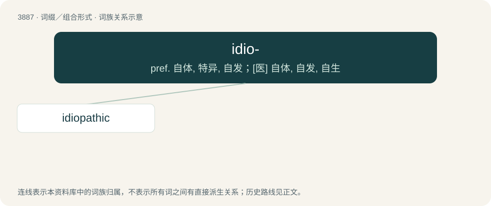

# 3914 · idio- — pref. 自体, 特异, 自发；\[医\] 自体, 自发, 自生

[总目录](../00_总目录_按常用程度.md)

**类型**：词缀／组合形式　｜　**来源语言**：见词源记录

## 核心含义与来源

- 核心含义：pref. 自体, 特异, 自发；\[医\] 自体, 自发, 自生
- 英文含义：individuality, peculiarity, separateness.
- 词形：idio-

## 词族图

## 单词速览（常用到不常用）

| 单词 | 音标 | 释义 |
|---|---|---|
| [idiopathic](#w-1) | /ˌɪdioʊˈpæθɪk/ | a. 自发的, 原发的, 特发的；\[医\] 自发的, 特发的 |

## 逐词详解

### 1. idiopathic

**词性**：形容词　｜　**音标**：/ˌɪdioʊˈpæθɪk/

**中文释义**：a. 自发的, 原发的, 特发的；\[医\] 自发的, 特发的

**英文义项**：Of, relating to, or designating a disease or condition having no known cause.

**构词拆分**：idio- + -pathic

**词源与演化**：

From idio- + -pathic. First appears c. 1669, in the publications of William Simpson.
