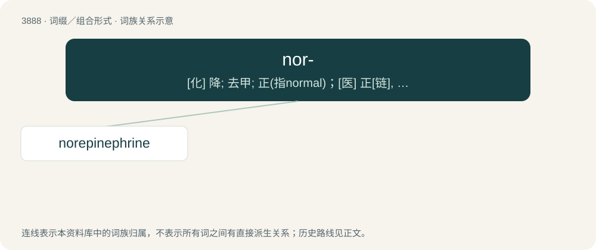

# 3915 · nor- — \[化\] 降; 去甲; 正(指normal)；\[医\] 正\[链\], 去甲, 降

[总目录](../00_总目录_按常用程度.md)

**类型**：词缀／组合形式　｜　**来源语言**：见词源记录

## 核心含义与来源

- 核心含义：\[化\] 降; 去甲; 正(指normal)；\[医\] 正\[链\], 去甲, 降
- 英文含义：A compound derived from another by removal of a radical, especially by removal of methyl or methylene.
- 词形：nor-

**来源记录 1**（前缀／前置成分；A compound derived from another by removal of a radical, especially by removal of methyl or methylene.）

An abbreviation of normal.

## 词族图

## 单词速览（常用到不常用）

| 单词 | 音标 | 释义 |
|---|---|---|
| [norepinephrine](#w-1) | /ˌnɔːɹɛpɪˈnɛfɹɪn/ | n. 去甲肾上腺素；\[化\] 去甲肾上腺素 |

## 逐词详解

### 1. norepinephrine

**词性**：名词　｜　**音标**：/ˌnɔːɹɛpɪˈnɛfɹɪn/

**中文释义**：n. 去甲肾上腺素；\[化\] 去甲肾上腺素

**英文义项**：A neurotransmitter found in the locus coeruleus which is synthesized from dopamine.

**构词拆分**：nor- + epinephrine

**词源与演化**：

From nor- + epinephrine.
