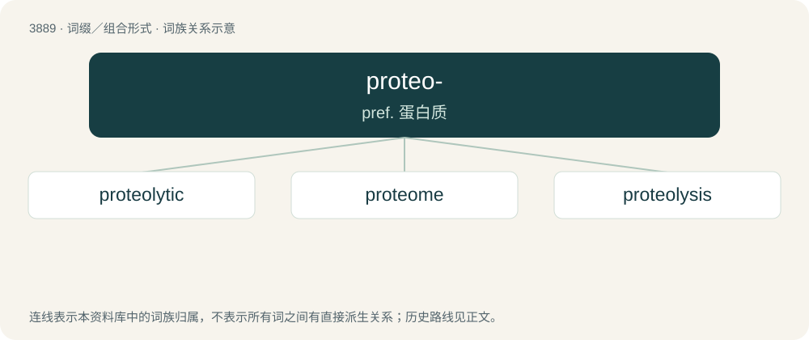

# 3916 · proteo- — pref. 蛋白质

[总目录](../00_总目录_按常用程度.md)

**类型**：词缀／组合形式　｜　**来源语言**：见词源记录

## 核心含义与来源

- 核心含义：pref. 蛋白质
- 英文含义：protein
- 词形：proteo-

## 词族图

## 单词速览（常用到不常用）

| 单词 | 音标 | 释义 |
|---|---|---|
| [proteolytic](#w-1) | /prəutiəˈlitik/ | a. 解朊的, 水解蛋白质的, 蛋白水解作用的；\[化\] 解蛋白的; 分解蛋白的 |
| [proteome](#w-2) | 英 /ˈpɹəʊtɪəʊm/ | 蛋白质组 |
| [proteolysis](#w-3) | /,prəutiˈɔlisis/ | n. 解朊作用, 蛋白水解作用；\[化\] 蛋白水解; 蛋白水解作用 |

## 逐词详解

### 1. proteolytic

**词性**：形容词　｜　**音标**：/prəutiəˈlitik/

**中文释义**：a. 解朊的, 水解蛋白质的, 蛋白水解作用的；\[化\] 解蛋白的; 分解蛋白的

**英文义项**：Of, relating to, or promoting proteolysis.

**构词拆分**：From proteo- + -lytic.

**词源与演化**：

From proteo- + -lytic.

### 2. proteome

**词性**：名词　｜　**音标**：英 /ˈpɹəʊtɪəʊm/

**中文释义**：蛋白质组

**英文义项**：The complete set of proteins encoded by a particular genome.

**构词拆分**：proteo- + -ome

**词源与演化**：

Blend of protein + genome or proteo- + -ome.

### 3. proteolysis

**词性**：名词　｜　**音标**：/,prəutiˈɔlisis/

**中文释义**：n. 解朊作用, 蛋白水解作用；\[化\] 蛋白水解; 蛋白水解作用

**英文义项**：The hydrolysis of proteins into peptides and amino acids, especially as part of the digestion of food.

**构词拆分**：proteo- + -lysis

**词源与演化**：

From proteo- + -lysis.
