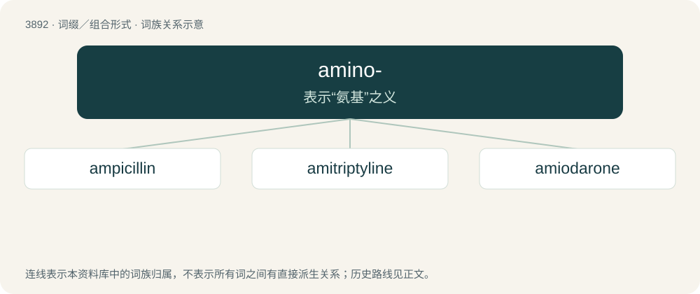

# 3918 · amino- — 表示“氨基”之义

[总目录](../00_总目录_按常用程度.md)

**类型**：词缀／组合形式　｜　**来源语言**：见词源记录

## 核心含义与来源

- 核心含义：表示“氨基”之义
- 英文含义：Of amines and of the amino functional group.
- 词形：amino-

**来源记录 1**（前缀／前置成分；Of amines and of the amino functional group.）

From amine + -o-.

## 词族图

## 单词速览（常用到不常用）

| 单词 | 音标 | 释义 |
|---|---|---|
| [ampicillin](#w-1) | /ˌæm.pɪˈsɪl.ɪn/ | n. 氨苄青霉素；\[化\] 氨苄西林; 氨苄青霉素 |
| [amitriptyline](#w-2) | 英 /æmɪˈtɹɪptɪliːn/ | n. 阿米替林(抗抑郁药)；\[化\] 阿米替林 |
| [amiodarone](#w-3) | 美 /əˈmi.əd.əˌɹoʊn/ | \[化\] 胺碘酮 |

## 逐词详解

### 1. ampicillin

**词性**：名词　｜　**音标**：/ˌæm.pɪˈsɪl.ɪn/

**中文释义**：n. 氨苄青霉素；\[化\] 氨苄西林; 氨苄青霉素

**英文义项**：A semisynthetic form of penicillin C₁₆H₁₉N₃O₄S that is effective against gram-negative and gram-positive bacteria and is used to treat infections of the urinary, respiratory, and intestinal tracts.

**构词拆分**：amino- + penicillin

**词源与演化**：

From am(ino)- + p(en)icillin.

### 2. amitriptyline

**词性**：名词　｜　**音标**：英 /æmɪˈtɹɪptɪliːn/

**中文释义**：n. 阿米替林(抗抑郁药)；\[化\] 阿米替林

**英文义项**：An antidepressant drug; a tablet containing this drug.

**构词拆分**：amino- + tri- + heptyl + -ine

**词源与演化**：

From ami(no-) + tri- + (he)ptyl + -ine.

### 3. amiodarone

**词性**：名词　｜　**音标**：美 /əˈmi.əd.əˌɹoʊn/

**中文释义**：\[化\] 胺碘酮

**英文义项**：an antiarrhythmic drug administered in the form of its hydrochloride C₂₅H₂₉I₂NO₃·HCl and used to treat life-threatening ventricular arrhythmia

**构词拆分**：amino- + iod- + coumarone

**词源与演化**：

From ami(no)- + iod- + (coum)arone (“benzofuran”).
