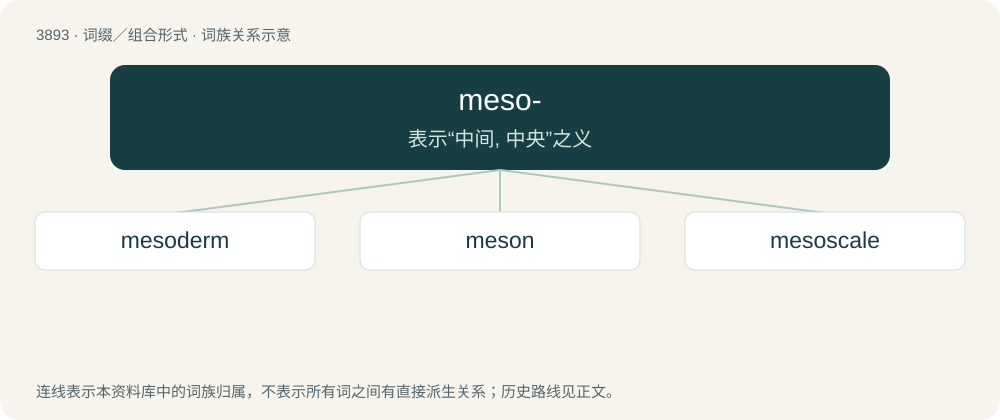

# 3919 · meso- — 表示“中间, 中央”之义

[总目录](../00_总目录_按常用程度.md)

**类型**：词缀／组合形式　｜　**来源语言**：见词源记录

## 核心含义与来源

- 核心含义：表示“中间, 中央”之义
- 英文含义：Middle or centre in location/position.
- 词形：meso-

**来源记录 1**（前缀／前置成分；Middle or centre in location/position.）

From Ancient Greek μέσος (mésos, “middle”). Doublet of mid- and medio-.

## 词族图

## 单词速览（常用到不常用）

| 单词 | 音标 | 释义 |
|---|---|---|
| [mesoderm](#w-1) | /ˈmesəudəːm/ | n. 中胚层；\[医\] 中胚层 |
| [meson](#w-2) | /ˈmiːzɒn/ | 【英文】An elementary particle that is composed of a quark and an antiquark, such as a kaon or pion. (Mesons composed of rarer quarks are much heavier.) |
| [mesoscale](#w-3) | /ˈmesəskeil/ | n. & adj.\[气\]中尺度(的) |

## 逐词详解

### 1. mesoderm

**词性**：名词　｜　**音标**：/ˈmesəudəːm/

**中文释义**：n. 中胚层；\[医\] 中胚层

**英文义项**：One of the three tissue layers in the embryo of a metazoan animal, which will produce, through development, many internal organs of the adult, e.g. muscles, spine and the circulatory system.

**构词拆分**：meso- + -derm

**词源与演化**：

From meso- + -derm.

### 2. meson

**词性**：名词　｜　**音标**：/ˈmiːzɒn/

**英文义项**：An elementary particle that is composed of a quark and an antiquark, such as a kaon or pion. (Mesons composed of rarer quarks are much heavier.)

**构词拆分**：meso- + -on

**词源与演化**：

From meso- + -on. Coined by Indian physicist Homi Bhabha in 1939, as a modification of the earlier suggestion mesotron.

### 3. mesoscale

**词性**：形容词　｜　**音标**：/ˈmesəskeil/

**中文释义**：n. & adj.\[气\]中尺度(的)

**英文义项**：Of medium size or extent; between microscale and macroscale. / Roughly 2–200 kilometers (or ~1-124 miles) in extent; between microscale and synoptic.

**构词拆分**：meso- + scale

**词源与演化**：

From meso- + scale.
