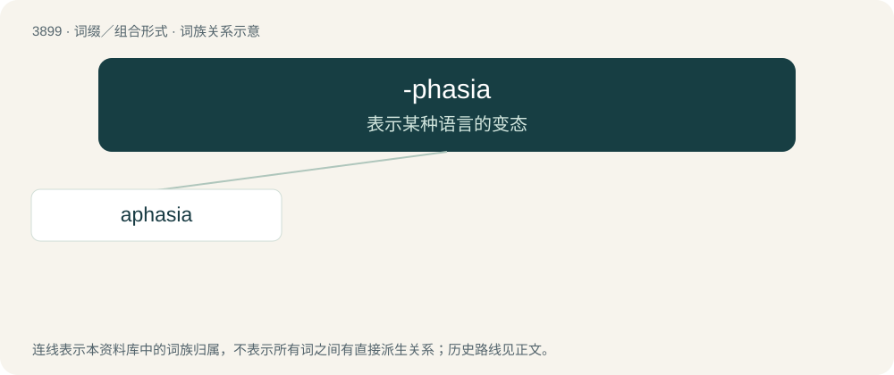

# 3921 · -phasia — 表示某种语言的变态

[总目录](../00_总目录_按常用程度.md)

**类型**：词缀／组合形式　｜　**来源语言**：见词源记录

## 核心含义与来源

- 核心含义：表示某种语言的变态
- 英文含义：Used to form the names of disorders and phenomena relating to words and speech.
- 词形：-phasia

**来源记录 1**（后缀／后置成分；Used to form the names of disorders and phenomena relating to words and speech.）

From Ancient Greek φάσις (phásis, “utterance”), from φημί (phēmí, “I say”).

## 词族图

## 单词速览（常用到不常用）

| 单词 | 音标 | 释义 |
|---|---|---|
| [aphasia](#w-1) | /əˈfeɪzɪə/ | n. 失语症；\[医\] 语言不能, 失语\[症\] |

## 逐词详解

### 1. aphasia

**词性**：名词　｜　**音标**：/əˈfeɪzɪə/

**中文释义**：n. 失语症；\[医\] 语言不能, 失语\[症\]

**英文义项**：A partial or total loss of language skills due to brain damage. Usually, damage to the left perisylvian region, including Broca's area and Wernicke's area, causes aphasia.

**构词拆分**：a- + -phasia

**词源与演化**：

From French aphasie, from Ancient Greek ἀφασία (aphasía), from ἄφατος (áphatos, “speechless”), from ἀ- (a-, “not”) + φάσις (phásis, “speech”). Equivalent to a- + -phasia.

**例句**：

> After Tom's brain injury, he had aphasia for almost a year.
