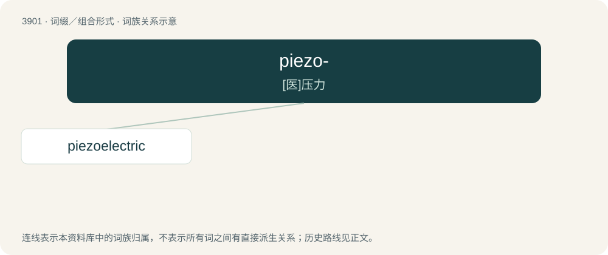

# 3924 · piezo- — \[医\]压力

[总目录](../00_总目录_按常用程度.md)

**类型**：词缀／组合形式　｜　**来源语言**：见词源记录

## 核心含义与来源

- 核心含义：\[医\]压力
- 英文含义：Forms terms related to piezoelectricity or other effects of mechanical stress or pressure.
- 词形：piezo-

**来源记录 1**（前缀／前置成分；Forms terms related to piezoelectricity or other effects of mechanical stress or pressure.）

From Ancient Greek πῐέζω (pĭézō, “to squeeze”).

## 词族图

## 单词速览（常用到不常用）

| 单词 | 音标 | 释义 |
|---|---|---|
| [piezoelectric](#w-1) | /pai,iːzəuiˈlektrik/ | \[电\] 压电的 |

## 逐词详解

### 1. piezoelectric

**词性**：形容词　｜　**音标**：/pai,iːzəuiˈlektrik/

**中文释义**：\[电\] 压电的

**英文义项**：of or relating to piezoelectricity

**构词拆分**：piezo- + electric

**词源与演化**：

From piezo- + electric.
