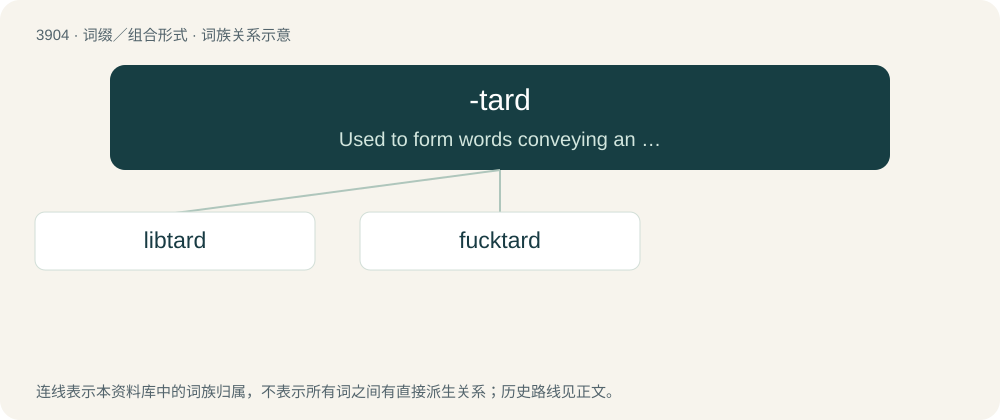

# 3927 · -tard — Used to form words conveying an attitude of contempt or doubt over the subject's intelligence.

[总目录](../00_总目录_按常用程度.md)

**类型**：词缀／组合形式　｜　**来源语言**：见词源记录

## 核心含义与来源

- 核心含义：Used to form words conveying an attitude of contempt or doubt over the subject's intelligence.
- 英文含义：Used to form words conveying an attitude of contempt or doubt over the subject's intelligence.
- 词形：-tard

**来源记录 1**（后缀／后置成分；Used to form words conveying an attitude of contempt or doubt over the subject's intelligence.）

From retard.

## 词族图

## 单词速览（常用到不常用）

| 单词 | 音标 | 释义 |
|---|---|---|
| [libtard](#w-1) | 美 /ˈlɪbtɑɹd/ | 【英文】An unintelligent liberal or progressive; a person who presents or advocates liberal views in an unintelligent or illogical manner. |
| [fucktard](#w-2) | 美 /ˈfʌktɑɹd/ | 【英文】An extraordinarily stupid person. |

## 逐词详解

### 1. libtard

**词性**：名词　｜　**音标**：美 /ˈlɪbtɑɹd/

**英文义项**：An unintelligent liberal or progressive; a person who presents or advocates liberal views in an unintelligent or illogical manner.

**构词拆分**：lib (“liberal”) + -tard

**词源与演化**：

Blend of liberal + -tard, equivalent to lib (“liberal”) + -tard.

**例句**：

> I'd rather be called a libtard than be confused for a "patriot".

### 2. fucktard

**词性**：名词　｜　**音标**：美 /ˈfʌktɑɹd/

**英文义项**：An extraordinarily stupid person.

**构词拆分**：fuck + -tard

**词源与演化**：

Blend of fuck(ing) + retard, or fuck + -tard.

**例句**：

> That fucktard spilled soda all over my keyboard!

该用例对应义项：An extraordinarily stupid person.
