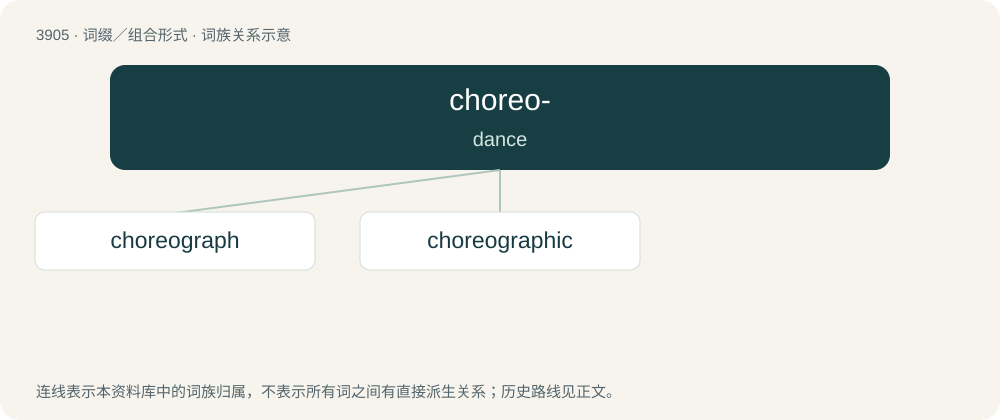

# 3928 · choreo- — dance

[总目录](../00_总目录_按常用程度.md)

**类型**：词缀／组合形式　｜　**来源语言**：见词源记录

## 核心含义与来源

- 核心含义：dance
- 英文含义：dance
- 词形：choreo-

**来源记录 1**（前缀／前置成分；dance）

From international scientific vocabulary, reflecting a New Latin combining form, from Ancient Greek χορεία (khoreía).

## 词族图

## 单词速览（常用到不常用）

| 单词 | 音标 | 释义 |
|---|---|---|
| [choreograph](#w-1) | 英 /ˈkɒɹiəɡɹɑːf/；美 /ˈkɔɹjəɡɹæf/ | v. 设计舞蹈动作 |
| [choreographic](#w-2) | /.kɒriəˈgræfik/ | a. 舞蹈艺术的, 舞台舞蹈的 |

## 逐词详解

### 1. choreograph

**词性**：动词　｜　**音标**：英 /ˈkɒɹiəɡɹɑːf/；美 /ˈkɔɹjəɡɹæf/

**中文释义**：v. 设计舞蹈动作

**英文义项**：To design and record the choreography for a dramatic work such as a ballet. / To direct the development of a project; to orchestrate.

**构词拆分**：choreo- + -graph

**词源与演化**：

Back-formation from choreography, equivalent to choreo- + -graph.

**例句**：

> I refuse to choreograph such a hideous and immoral production.

### 2. choreographic

**词性**：形容词　｜　**音标**：/.kɒriəˈgræfik/

**中文释义**：a. 舞蹈艺术的, 舞台舞蹈的

**英文义项**：Of or pertaining to choreography. / Balletic.

**构词拆分**：choreography + -ic；choreo- + -graphic

**词源与演化**：

From choreography + -ic or choreo- + -graphic.
