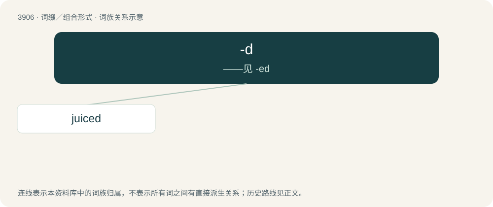

# 3929 · -d — ——见 -ed

[总目录](../00_总目录_按常用程度.md)

**类型**：词缀／组合形式　｜　**来源语言**：见词源记录

## 核心含义与来源

- 核心含义：——见 -ed
- 英文含义：An empty suffix, perhaps derived from the past-tense suffix above, added in some dialects to the present tense forms of some words which then add an additional -ed in the past tense.
- 词形：-d

## 词族图

## 单词速览（常用到不常用）

| 单词 | 音标 | 释义 |
|---|---|---|
| [juiced](#w-1) | /dʒuːst/ | a. 有汁的,喝醉的 |

## 逐词详解

### 1. juiced

**词性**：形容词　｜　**音标**：/dʒuːst/

**中文释义**：a. 有汁的,喝醉的

**英文义项**：That has had the juice extracted. / Drunk.

**构词拆分**：From juice + -d.

**词源与演化**：

From juice + -d.

**例句**：

> The whole school is juiced about tonight's game.

该用例对应义项：Excited.
