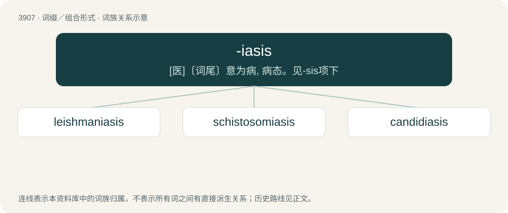

# 3930 · -iasis — \[医\]〔词尾〕意为病, 病态。见-sis项下

[总目录](../00_总目录_按常用程度.md)

**类型**：词缀／组合形式　｜　**来源语言**：见词源记录

## 核心含义与来源

- 核心含义：\[医\]〔词尾〕意为病, 病态。见-sis项下
- 英文含义：A pathological condition or process.
- 词形：-iasis

**来源记录 1**（后缀／后置成分；A pathological condition or process.）

A Latin word-forming element meaning "process" or "morbid condition". Originally from Ancient Greek ἴασις (íasis). By surface analysis, -i- + -asis.

## 词族图

## 单词速览（常用到不常用）

| 单词 | 音标 | 释义 |
|---|---|---|
| [leishmaniasis](#w-1) | /liːʃməˈnaɪəsɪs/ | \[医\] 利什曼病 |
| [schistosomiasis](#w-2) | /.ʃistəsəuˈmaiəsis/ | n. 血吸虫病；\[医\] 血吸虫病 |
| [candidiasis](#w-3) | /ˌkændɪˈdaɪəsɪs/ | \[医\] 念珠菌病 |

## 逐词详解

### 1. leishmaniasis

**词性**：名词　｜　**音标**：/liːʃməˈnaɪəsɪs/

**中文释义**：\[医\] 利什曼病

**英文义项**：Any of several distinct forms of a disease caused by any of the protozoans of the genus Leishmania, transmitted to humans and animals by bloodsucking sandflies.

**词源与演化**：

Leishmania + -iasis

**例句**：

> Antimony compounds are the main therapy against all leishmaniasis, including the often fatal version called kala-azar that attacks organs.

### 2. schistosomiasis

**词性**：名词　｜　**音标**：/.ʃistəsəuˈmaiəsis/

**中文释义**：n. 血吸虫病；\[医\] 血吸虫病

**英文义项**：Any of various diseases of humans caused by parasitic blood flukes of the genus Schistosoma.

**构词拆分**：schistosome + -iasis

**词源与演化**：

From schistosome + -iasis. From scientific name Schistosoma + Ancient Greek -σις (-sis, nouns of action).

**例句**：

> Schistosomiasis is a tropical disease that affects millions of people and may lead to severe disabilities or even death.

### 3. candidiasis

**词性**：名词　｜　**音标**：/ˌkændɪˈdaɪəsɪs/

**中文释义**：\[医\] 念珠菌病

**英文义项**：A fungal infection due to any species of yeasts in the genus Candida or those that were formerly classified in the genus Candida but are now classified in the genus Candidozyma.

**词源与演化**：

Candida + -iasis
