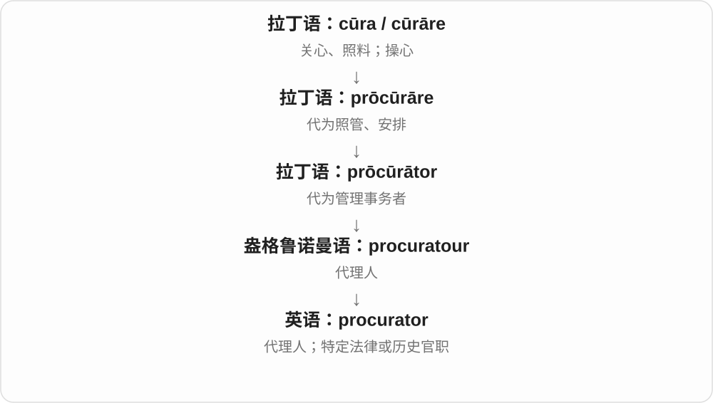

# 3933 · -ator — 执行某动作的人、职务名称材料

[逐词精讲目录](../00_逐词精讲目录.md) · [总目录](../00_总目录_按常用程度.md)

## 核心词根与来源

来自拉丁 -ator 动作执行者材料，或按动词词干与 -or 的相应关系认识。英语很多完整词直接借自拉丁、法语，并非都在英语里先造动词。

**-ATOR：把动作关系变成做这件事的人**

procurator 是历史、法律、教会等语境里的代理人、管理者称呼。前部动作词族决定他代理、管理什么，不能只背人这个后缀。

- **代理、管理等职务名称**：procurator

## 词形与演化规律

拉丁 procurare 管理、照料、代理 → procurator；后部属于拉丁动作执行者名词形成方式。

## 单词速览（按词族由简到繁）

同一基础词的相关扩展放在一起，先读基础形式，再读扩展；各组之间优先读常用的。具体词源关系见各词讲解。

| 单词 | 音标 | 核心意思 |
|---|---|---|
| [procurator](#w-1) | 英 /ˌprɒkjəˈreɪtə/；美 /ˈprɑːkjəˌreɪtər/ | 代理人；检察官；古罗马财务或行政官 |

## 逐词讲解

### 1. procurator — 代理人；检察官；古罗马财务或行政官

**音标**：英 /ˌprɒkjəˈreɪtə/；美 /ˈprɑːkjəˌreɪtər/

**先抓住这个画面**

有人受托代别人照管事务，procurator 的历史核心就是这位办理人；不同制度把它用作不同官职。

**怎么拆**

拉丁语 prōcūrātor“管理、代理的人”，经法语与中古英语传入。

**怎么变成今天的意思**

古罗马可指管理税务等的官员，某些现代制度中译作检察官。不能把不同国家、时期的职责都视为完全一样。

**常见搭配与例句**

a Roman procurator；a public procurator；act as procurator。

> The historian described the duties of a Roman procurator.

历史学家介绍了古罗马行省财务官的职责。

> The text uses procurator as the title of a legal official.

文本用 procurator 作为一种司法官员的称号。

**别混淆**

proctor 是同源词缩短后的形式，但现代常指监考员；procurator 不适合随意替换所有 lawyer。

## 这一组要分清什么

procurator 的具体职务随历史、机构而变；不能把现代每个 manager 都译成这个较专门的名称。

## 串起来练习

The historian described the duties of the procurator.

历史学家描述了那位行政官的职责。
