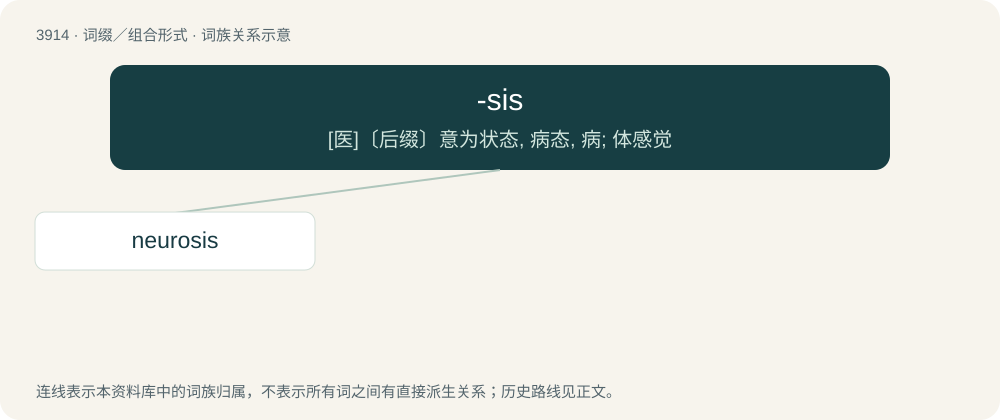

# 3942 · -sis — \[医\]〔后缀〕意为状态, 病态, 病; 体感觉

[总目录](../00_总目录_按常用程度.md)

**类型**：词缀／组合形式　｜　**来源语言**：见词源记录

## 核心含义与来源

- 核心含义：\[医\]〔后缀〕意为状态, 病态, 病; 体感觉
- 英文含义：forming nouns of action or process
- 词形：-sis

**来源记录 1**（后缀／后置成分；forming nouns of action or process）

Ultimately from Ancient Greek -σις (-sis, “forms noun of action”), often via Latin or French. Identical in meaning with Latin -entia, English -ing.

## 词族图

## 单词速览（常用到不常用）

| 单词 | 音标 | 释义 |
|---|---|---|
| [neurosis](#w-1) | 英 /n(j)ʊˈɹəʊ̯.sɪs/；美 /n(j)ʊˈɹoʊ̯.sɪs/ | n. 神经症, 神经机能病；\[医\] 神经机能病, 神经\[官能\]症 |

## 逐词详解

### 1. neurosis

**词性**：名词　｜　**音标**：英 /n(j)ʊˈɹəʊ̯.sɪs/；美 /n(j)ʊˈɹoʊ̯.sɪs/

**中文释义**：n. 神经症, 神经机能病；\[医\] 神经机能病, 神经\[官能\]症

**英文义项**：A mental disorder, less severe than psychosis, marked by anxiety or fear differing from normal measures by its intensity, and resulting from a failure to compromise or properly adjust during the developmental stages of life, between normal human instinctual impulses and the demands of human society.

**构词拆分**：neuro- + -sis

**词源与演化**：

From neuro- + -sis.

**例句**：

> Neurosis is a trait often stereotypically assigned to Ashkenazi Jews.
