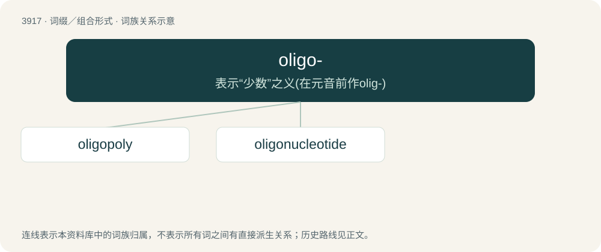

# 3945 · oligo- — 表示“少数”之义(在元音前作olig-)

[总目录](../00_总目录_按常用程度.md)

**类型**：词缀／组合形式　｜　**来源语言**：见词源记录

## 核心含义与来源

- 核心含义：表示“少数”之义(在元音前作olig-)
- 英文含义：few, several
- 词形：oligo-

**来源记录 1**（前缀／前置成分；few, several）

From Ancient Greek ὀλίγος (olígos, “few”), from Proto-Indo-European \*h₃ligos (“poor, miserable”).

## 词族图

## 单词速览（常用到不常用）

| 单词 | 音标 | 释义 |
|---|---|---|
| [oligopoly](#w-1) | 英 /ɒlɪˈɡɒpəli/；美 /ˌɑləˈɡɑpəli/ | n. 求过于供的市场情况, 寡头买主垄断 |
| [oligonucleotide](#w-2) | /,ɔli^əjˈnjuːkliəjtaid,-tid,ə,li-/ | \[化\] 低核苷酸; 低聚核苷酸; 寡核苷酸 |

## 逐词详解

### 1. oligopoly

**词性**：名词　｜　**音标**：英 /ɒlɪˈɡɒpəli/；美 /ˌɑləˈɡɑpəli/

**中文释义**：n. 求过于供的市场情况, 寡头买主垄断

**英文义项**：An economic condition in which a small number of sellers exert control over the market of a commodity.

**构词拆分**：oligo- (prefix meaning ‘few; several’) + -poly (suffix meaning ‘pertaining to the number of sellers in a market’)

**词源与演化**：

From oligo- (prefix meaning ‘few; several’) + -poly (suffix meaning ‘pertaining to the number of sellers in a market’), by analogy with monopoly.

**例句**：

> An oligopoly is an imperfect monopoly.

### 2. oligonucleotide

**词性**：名词　｜　**音标**：/,ɔli^əjˈnjuːkliəjtaid,-tid,ə,li-/

**中文释义**：\[化\] 低核苷酸; 低聚核苷酸; 寡核苷酸

**英文义项**：A short sequence of nucleotides (RNA or DNA), typically with twenty or fewer base pairs.

**构词拆分**：oligo- + nucleotide

**词源与演化**：

From oligo- + nucleotide.
